<p align="center">
  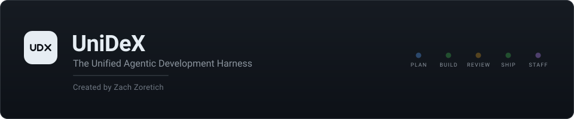
</p>

<p align="center">
  <strong>A second brain for Claude Code and Codex CLI, and a macOS app that renders it.</strong><br />
  Persistent memory · recall · session capture · a named Chief of Staff · a live monitor of it all.
</p>

<p align="center">
  <a href="https://github.com/zzoretich/UniDeX-Agent-Harness/actions/workflows/ci.yml"></a>
  
  
  
  <a href="LICENSE"></a>
</p>

<p align="center">
  <a href="#quick-start">Quick start</a> ·
  <a href="#prerequisites">Prerequisites</a> ·
  <a href="#installation">Installation</a> ·
  <a href="#screenshots">Screenshots</a> ·
  <a href="#your-first-session">First session</a> ·
  <a href="#chief-of-staff">Chief of Staff</a> ·
  <a href="#everyday-commands">Commands</a> ·
  <a href="#how-it-works">How it works</a> ·
  <a href="#docs">Docs</a>
</p>

<p align="center"></p>

Claude Code and Codex CLI forget everything between sessions. UniDeX gives them a vault they can read from on every prompt and write back to at the end of every session, then puts a dashboard on top, the UniDeX app, so you can see what they remember, what ran, and what it cost.

It works with **Claude Code alone**, with **Codex CLI alone**, with both sharing one vault, or with neither yet. Background work (session summaries, memory, insights, the briefing, the AI buttons) runs on a model on your Mac and never spends. Nothing about you ships in this repository, and background work only ever goes through the local model on your Mac or your own Claude Code or Codex login, never a third-party service.

<a name="what-you-get"></a>
##  What you get

| | |
|---|---|
|  | **Memory that persists.** Facts, feedback rules, projects and references live in your vault as plain Markdown. Every new session opens with a compiled `<brain-context>` block; `/wrap` writes what the session learned. |
|  | **Recall.** Hybrid search over memories, patterns and daily notes, exposed to Claude Code as the `agenticos` MCP server (`recall`, `memory_search`, `session_recall`, `feedback_rules`, …). |
|  | **A knowledge graph of the vault.** [graphify](https://github.com/Graphify-Labs/graphify) maps your notes — pages, headings, `[[links]]`, communities, hubs — and every scan keeps it current, locally and with no model. A daily model pass on its own budget adds concepts and inferred links. Claude asks it through `graph_query`, `graph_neighbors`, `graph_path` and `graph_overview`; `aos graph` shows it. |
|  | **Session capture.** Daily notes, working-memory summaries, telemetry with redaction on by default, and a pipeline ledger that shows what ran and when. |
|  | **Local first, and your history comes with you.** Background work runs on a model on your Mac (Ollama, or an OpenAI-compatible server), sized to its memory, and never spends; when it is down, the work waits or uses heuristics instead of falling back to a paid model. `aos import` brings in what Claude Code and Codex already know: your global instructions as rules, Claude Code's memories, both hosts' MCP servers, your project folders as workspaces, and your past sessions, digested on the local model. |
|  | **A Chief of Staff.** A named agent you interview once. Its identity and state ride along on every prompt; five scheduled duties and a heartbeat watchdog keep the vault honest, notice what changed and file proposals for anything that needs your sign-off. Guarded files never change without your approval, and there is a kill switch. [The whole layer →](#chief-of-staff) |
|  | **Routines.** Recurring actions as files — `brain/routines/<slug>.md` with a cron schedule and a kind (a persona duty, a prompt for the built-in local agent, Claude Code or Codex, or a command). One `aos routines sync` renders the launchd or cron schedules; the HUD tab shows next fire, last run and health, and edits the same files. The same tab lists, read-only, the routines your session hosts own: Codex app Automations and Claude Code cloud routines. |
|  | **Universal skills.** A skill you write for Claude Code (`~/.claude/skills`) works in Codex, and one you write for Codex (`~/.agents/skills`) works in Claude Code. With both hosts enabled, every session end copies each host's own skills into the other host's folder, translated to its idioms (`$ARGUMENTS`, questions, `/name` ⇄ `$name`) and marked so a hand edit is never overwritten. `aos skills` and the Skills tab list them all, plugin skills and built-ins included. |
|  | **Universal agents.** A subagent you write for Claude Code (`~/.claude/agents/<name>.md`) works in Codex, and one you write for Codex (`~/.codex/agents/<name>.toml`) works in Claude Code. With both hosts enabled, every session end copies each host's own agents into the other host's folder, translated between Markdown and TOML: the name, description and prompt carry over, an agent whose tools cannot write runs read-only on the other host, and each host keeps its own model. A copy is marked so a hand edit is never overwritten, and a name that would replace a host's built-in agent is never copied. `aos agents` and the Agents tab list them all, plugin agents and Codex `config.toml` roles included. |
|  | **The UniDeX app.** A macOS app with a Files view (the vault tree, quick open, search and a Markdown editor) and thirteen more tabs — Pulse, the Home tab (your Chief of Staff's briefing over ten tiles: what needs you, system health, agents, workspaces, to-dos, decisions, notifications, routines, spend and the brain, each opening one popup where its rows act or jump to their review, with no scrolling), To-Do (your `TODO.md` in Tasks syntax, grouped by due date and priority), Proposals (the Chief of Staff's pending proposals, backlog and decision history, with a count badge), Notifications (what agents, routines and duties post, with an unread badge), Spaces (each workspace as a dossier: a list grouped by status and searchable by name, branch or next step; a pick-up card with the last Claude Code or Codex thread, the handoff's Now line, the next step and the insight; Overview, a Files tree with each file's map description inline, and the workspace's history and linked to-dos, proposals and memory notes; Resume in Code reopens the last thread on its own host, and Spaces, Sessions, Code and Pulse link to each other by workspace), Brain (Review: what your sessions wrote, by the session that wrote it, to keep, archive, pin, or set beside the memory it looks like and merge into one: a model drafts the merged memory or you combine it by hand, nothing is written until you save, and Undo merge reverts it for 30 days; Library: every memory, feedback draft, pattern and reflection, with its use, links, look-alikes and history; Bootstrap: what every new session starts with, against its budgets, with Unpin, Mark complete and a recall preview; Map: your memories' communities in the knowledge graph; Health: duplicates to compare or merge, one-click hygiene fixes with a dry run first, the memories nothing uses, and a consolidation sweep whose merge, archive and retitle suggestions you apply one at a time, over the whole brain or one cluster or Map community), Runs, Routines, Skills (every Claude Code and Codex skill, runnable on either host), Agents (every Claude Code and Codex agent, startable on either host), Agent Teams (the gates waiting on you across your teams, then each team's work board, roster, channel and seat settings, with a badge counting the gates), Sessions (agent sessions in a workspace on Claude Code or Codex, laid out like Claude Code: one menu picks the host and a model from that host's own list, with its effort, and the model, effort and access — read only, edit files, or edit and run commands — can change on any turn; `/` lists the host's commands, or Codex's skills as `$name`; tool calls read as `Update(file)` lines with a plan card, a status line shows the turn's model, spend and branch, and Review changes (with +/− counts) and Commit act on what changed; Vault, the chat about your notes, comes first in its list and asks any host per question, always read only) and Code (the embedded terminals, with a composer for agent prompts), on a rail in three sections — plus ⚙ Settings and Help pinned to the rail's foot (Help: a guided tour of the app and of every tab, What's new, and a Getting started checklist), a sidebar carrying the update and heartbeat pills, and a menubar item. |
|  | **One settings panel.** ⚙ Settings, at the bottom-left of the Workbench rail, shows every setting of the whole system in one place: master switches (background AI, the Chief of Staff, routines, the graph, cross-review, costing, telemetry, update checks, sharing), then each section — provider and models, spend limits with today's spend against each cap, memory and scanning, the Chief of Staff, routines, the graph, cross-review, telemetry, updates — and the plugin's own settings. Nothing is typed: every setting is a toggle, a preset picker (numbers also step with − / +), chips or a button, and a value set outside the presets stays shown. Every change goes through `aos config`, so it lands in the file that actually wins, atomically; raising a cap or widening an agent's autonomy asks first, and steps a change leaves (a schedule sync) become one-click buttons. Rows for a host you have not enabled are dimmed and point at **Add Claude Code** / **Add Codex** under Hosts (`aos hosts add`); Local engine shows the model on this Mac, and Import brings in your Claude Code and Codex history. |
|  | **Cost, opt-in.** A python analyzer that costs every session from its transcript, with a monthly budget in the HUD. Off unless you turn it on. |

<a name="quick-start"></a>
##  Quick start

1. Download **UniDeX** from the [latest release](https://github.com/zzoretich/UniDeX-Agent-Harness/releases/latest) (`AgenticOS-Workbench-<version>-arm64.dmg`, for Macs with Apple silicon on macOS 13 or later), open it and drag the app to Applications.
2. Open the app. Its setup wizard installs what UniDeX needs itself (Node, uv, Ollama and its model; Claude Code and Codex if you want them), with nothing on the Mac beforehand: no Homebrew, no Node, no terminal. It asks which hosts (or none yet) and which vault folder, asks your Chief of Staff's questions, installs, offers to bring in your Claude Code and Codex history, and opens the Workbench on a guided tour.
3. Start a `claude` or `codex` session: the first prompt already carries your brain context. In Codex, first run `/hooks` once and trust the agenticos entries, as the wizard's last step reminds you; until then they do not run. Installed without a host? Add one later with `aos hosts add claude` (or `codex`), or under Settings ▸ Hosts.

<p align="center">
  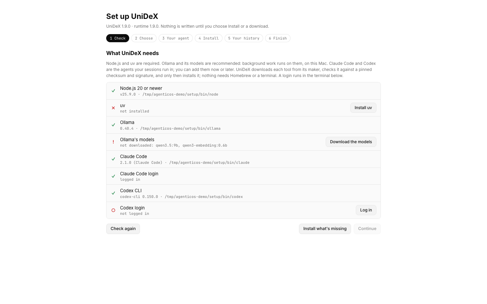
  <br /><sub><b>The setup wizard.</b> Each prerequisite is checked, and a missing one gets a button that installs it (here: install uv, log in to Codex).</sub>
</p>

Prefer a terminal? The same install runs from a clone:

```sh
git clone https://github.com/zzoretich/UniDeX-Agent-Harness.git
cd UniDeX-Agent-Harness
npm ci --ignore-scripts
npm run setup                          # interactive installer (= node cli/aos.js init)
```

Then add the one line the installer prints to `~/.claude/CLAUDE.md` (Claude Code) or trust the hook entries once under `/hooks` (Codex), and open the app. Either path takes under ten minutes; the details are in [Installation](#installation). Updating from 1.x? [docs/migrating-to-2.0.md](docs/migrating-to-2.0.md) says what the update asks and how to undo it. Coming from a release before 1.0, where the Workbench ran in Obsidian? Read [docs/migrating-to-1.0.md](docs/migrating-to-1.0.md).

<a name="prerequisites"></a>
##  Prerequisites

| | Required? | What the app's wizard and the installer check |
|---|---|---|
| **macOS** | required | UniDeX supports macOS only: the Workbench is a macOS app, built for Apple silicon and macOS 13 or later, and schedules run through launchd. The runtime's Linux code paths (cron) are still there, but untested and unsupported; Windows is not supported. |
| **Node.js 20 or newer** | required | `node -v` prints `v20` or later. The app's wizard installs its own (from nodejs.org, into `~/.local/share/unidex/node`) when there is none; from a terminal you bring it. CI runs on 20 and 22. |
| **uv** | required | `uv` on PATH, or in `~/.local/bin` or `~/.cargo/bin`. It installs the pinned graphify with a Python of its own, so graphify never needs a system python. The wizard installs it; from a terminal, its [installer](https://docs.astral.sh/uv/). |
| **Ollama** | recommended | `ollama` on PATH, or `Ollama.app` (macOS 14 or later). Background work runs on it, on `127.0.0.1:11434`, with a model sized to the Mac: `qwen3.5:4b` under 12 GB of memory, else `qwen3.5:9b`, plus `qwen3-embedding:0.6b` for recall. The wizard installs the app and pulls the models; from a terminal, install it from ollama.com and run `aos local pull`. Without it, background work waits or uses heuristics. Any OpenAI-compatible server (LM Studio, llama.cpp) works instead. |
| **Claude Code and/or Codex CLI, logged in** | optional | `claude auth status` reports a login, or `codex login status` does (or both). `aos init` wires every host it finds; `--host claude\|codex\|both\|none` picks. With neither, the vault, its memory and the background work are set up, and Sessions and the Chief of Staff wait until you add one with `aos hosts add`. |
| **git** | terminal path only | For `git clone`. On macOS it arrives with the Command Line Tools; accept the install dialog if one appears. |
| **python3 3.9 or newer** | cost module only | `python3 --version` prints 3.9 or later. Checked by `aos cost enable` (and `aos init --cost`), the one thing that runs it. |

The installer refuses to use `~/.claude` as the vault, and refuses any directory that already holds a `settings.json`. The default vault is `~/AgenticOS`.

The app's wizard needs none of these first: each missing tool has a button that downloads a version pinned in the app from its maker, checks its checksum and code signature before installing it, and shows its progress; **Install what's missing** runs Node, uv, Ollama and its models one after another, and the logins run in a terminal inside the wizard, so you see the command and can type the code it asks for. Nothing needs Homebrew.

Obsidian is not needed: the Workbench is the **UniDeX** app, which reads the vault the installer records. The vault stays plain Markdown, so you can still open it in any editor you like.

<p align="center"></p>

<a name="installation"></a>
##  Installation

### With the app

Download `AgenticOS-Workbench-<version>-arm64.dmg` from the [latest release](https://github.com/zzoretich/UniDeX-Agent-Harness/releases/latest), open it, drag **UniDeX** to Applications and open it. The app is signed and notarized, and carries the runtime inside it. With no install on this Mac it opens a setup wizard:

1. **Check** — Node 20+ and uv (required), Ollama and its models (recommended; a warning, never a blocker), and Claude Code, Codex and their logins (optional). Each missing tool's button downloads a version pinned in the app from its maker, checks the download's SHA-256 and its code signature, installs it and shows its progress; **Install what's missing** runs Node, uv, Ollama and its models one after another, and **Log in** runs the host's login in a terminal inside the wizard. Nothing needs Homebrew.
2. **Choose** — which of Claude Code and Codex to wire (only the ones installed and logged in), or **No agent CLI yet**, and the vault folder (default `~/AgenticOS`; files already there are kept).
3. **Your agent** — the Chief of Staff's questions, as a form, with its models preselected (Claude Code · `claude-opus-5-5`, Codex · `gpt-6-sol`); skip it and run `aos persona` later. With no host yet it waits, and the first host you add (`aos hosts add`) sets it up.
4. **Install** — `aos init` from the runtime the app carries, with its output shown: the same steps as the terminal install below.
5. **Your history** — what Claude Code and Codex left on this Mac, counted per host and kind (instructions, memories, MCP servers, sessions) and the project folders it would make into workspaces, all ticked; **Import** brings in what stays ticked, with its progress, and queues the sessions for the digest. With nothing on this Mac, the step is skipped.
6. **Finish** — what is left, step by step: for Claude Code, the `CLAUDE.md` line shown as a diff and added only if you say so; for Codex, trusting the hook entries under `/hooks`; with no host, how to add one; and **Add aos to my PATH**, which appends `export PATH="$HOME/.local/bin:$PATH"` to `~/.zprofile` while it is ticked. Then the Workbench opens on its welcome tour.

Afterwards the app keeps itself current from GitHub Releases (UniDeX ▸ Check for Updates…), and when it carries a newer runtime than your vault has, it offers to run `aos upgrade` from it. Every step is in [docs/install.md](docs/install.md#from-the-app).

### From a terminal

The same install from a clone of this repository, which is also how CI tests it.

### 1. Clone and install dependencies

```sh
git clone https://github.com/zzoretich/UniDeX-Agent-Harness.git
cd UniDeX-Agent-Harness
npm ci --ignore-scripts
```

`--ignore-scripts` is enough for the installer and the test suites. The app has its own dependencies under `app/` ([app/README.md](app/README.md)).

### 2. Run the installer

```sh
npm run setup
```

`aos init` walks through nine steps, asking for a vault directory (default `~/AgenticOS`) right after the preflight, and prints a checklist at the end:

1. **Preflight** — Node ≥ 20 and uv; the hosts you wire (`claude`, `codex`) on PATH and logged in, or none with `--host none`. Any of these missing stops the install before anything is written. A missing Ollama is a warning (background work waits for it), and python3 is checked only with `--cost`.
2. **Seed the vault** — the template files and a `brain/config.json` with the shipped defaults. Existing files are kept.
3. **Vendor the runtime** — the scripts, the `aos` subcommands, the persona templates and the schedule and cost sources into `<vault>/brain/scripts`, plus a symlink at `~/.local/bin/aos`.
4. **Write `~/.claude/agenticos.json`** — the vault path, the node (for a Homebrew Node, its stable `opt/` link, which survives `brew upgrade`; for the app's own Node, its `current` link), `claude` and `codex` binaries it resolved, the enabled hosts, the provider (`local` on a new install), spend caps, telemetry and feature flags. Honours `CLAUDE_CONFIG_DIR`.
5. **Install graphify** — the pinned version through uv into `~/.local/share/agenticos/graphify` (never your own uv tools or PATH), recorded as `graph.bin`, plus a `.graphifyignore` in the vault.
6. **Wire the hosts** — Claude Code: the plugin (hooks, the MCP server, slash commands and skills) from this repository's marketplace. Codex CLI: the Codex plugin from the same marketplace (the same hooks, the MCP server, and the 21 commands plus 9 skills as Codex skills: `$agenticos:wrap`, `$agenticos:remember`, …). A Codex CLI without plugin support gets the same pieces written into its own config instead: five hook entries in `~/.codex/hooks.json`, `codex mcp add agenticos`, and skills under `~/.agents/skills/` (`$wrap`, `$remember`, …).
7. **The Chief of Staff interview** — name your agent (say, *Atlas*), how it addresses you, its voice, what it should watch, the model and effort for background duties, and whether to schedule the daily duties. Skipped with `--host none`: once you add a host, `aos persona` asks it.
8. **First scan** — compiles `BRAIN.md`, builds the recall index and the vault graph.
9. **Checklist** — every file written, the line to add to your `CLAUDE.md` or the `/hooks` entries to trust in Codex, and how to open the Workbench.

Useful flags: `--vault <dir>` · `--host auto|claude|codex|both|none` · `--provider local|auto|ollama|claude|codex|none` · `--cost [--budget <usd>]` · `--persona-json <file>` (answer the interview from a file; use it wherever stdin is not a terminal) · `--yes` (accept defaults, no prompts) · `--dry-run` (run the preflight, then print the numbered plan of the steps that write, starting at the seed; write nothing). Working from a checkout? `npm run setup -- --from-local .` installs the plugin from your clone instead of GitHub. A misspelled flag is a usage error, so a typo never starts a real install. `--no-obsidian` and `--terminal`, from releases that installed the Obsidian HUD, are still accepted and do nothing.

### 3. Put `aos` on your PATH and check the install

```sh
export PATH="$HOME/.local/bin:$PATH"   # add the same line to ~/.zprofile or ~/.bashrc
aos doctor                             # exits 0 when every check passes
aos local pull                         # with Ollama installed: download this Mac's model and the embedder
```

### 4. Wire Claude Code to the vault

The installer never edits your `CLAUDE.md`. Add the line it printed — it looks like this, with your vault's absolute path:

```
@/path/to/AgenticOS/AGENTICOS.md
```

### 4b. Wire Codex CLI to the vault

Nothing to paste: Codex's `AGENTS.md` has no include syntax, so a SessionStart hook injects `AGENTICOS.md` at every session start (and again after compaction). `aos init` installs the Workbench as a Codex plugin, `agenticos@agenticos-workbench`, from the same repository (Codex reads `.agents/plugins/marketplace.json`, which points at `codex-plugin/`). To install it by hand instead:

```sh
codex plugin marketplace add zzoretich/UniDeX-Agent-Harness
codex plugin add agenticos@agenticos-workbench
```

Codex quarantines new hooks until you have seen them once: open `codex`, run `/hooks`, and trust the agenticos entries. They stay trusted across upgrades, because Codex checks each command as written and the plugin's commands never name a version or a path. Slash commands are skills there, named the way Claude Code names plugin commands: `$agenticos:wrap`, `$agenticos:remember`, `$agenticos:brain`, and so on. Add Codex to an existing install with `aos hosts add codex` (Claude Code: `aos hosts add claude`); remove just that host with `aos uninstall --host codex`.

A Codex CLI that predates plugins is wired directly instead (hook entries in `~/.codex/hooks.json`, `codex mcp add agenticos`, skills under `~/.agents/skills/` named `$wrap`, `$remember`, …). The first `aos upgrade` on a CLI that installs plugins moves such an install to the plugin and removes the direct wiring, so the two never run side by side; Codex then asks once more to trust the hooks under `/hooks`.

### 5. Open the Workbench

Open the **UniDeX** app ([download](https://github.com/zzoretich/UniDeX-Agent-Harness/releases/latest)). It finds your vault through `~/.claude/agenticos.json`, skips its wizard, offers the guided tour once, and opens on Home, Pulse: your Chief of Staff's briefing over ten tiles, all on one screen. The briefing is written by the `briefing` routine when the facts change (one background model call, under the Chief of Staff's daily cap) and composed from the same facts until then; on a vault from before 1.5.0, **Turn on <name>'s briefing** on Pulse adds the routine. Each start records the app in the vault (`brain/_index/hud-host.json`), so `aos doctor` and the update check can see it. To run it from this checkout instead, see [app/README.md](app/README.md).

<p align="center"></p>

<a name="screenshots"></a>
##  Screenshots

UniDeX on a demo vault, in its light theme with one picture in dark. Everything in these pictures is made up: an agent called Nimbus, two workspaces, a small agent team and its sub-team, a few memories, to-dos and notifications. `npm run screens` in `app/` takes them again.

<p align="center">
  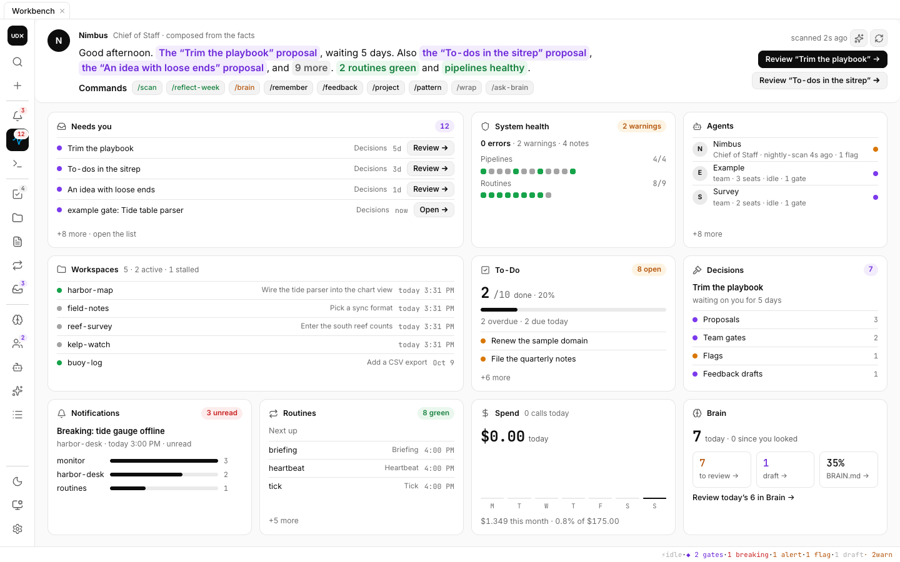
  <br /><sub><b>Pulse.</b> Home: your Chief of Staff's briefing, then what needs you, system health, agents, workspaces, to-dos, decisions, notifications, routines, spend and the brain. A tile opens one popup; its rows act in place, and decisions jump to their review.</sub>
</p>

<table>
  <tr>
    <td width="50%" valign="top">
      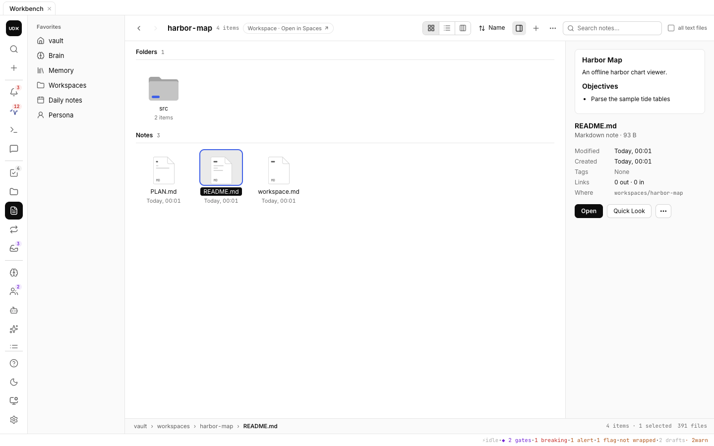
      <br /><sub><b>Files.</b> The vault as a Finder window: Icons with thumbnails, List and Columns, a preview and Quick Look, drag to move with the links following, smart folders and tags, and search by name or contents.</sub>
    </td>
    <td width="50%" valign="top">
      
      <br /><sub><b>To-Do.</b> Your <code>TODO.md</code> in Tasks syntax, grouped by due date, with quick-add, tags and priorities.</sub>
    </td>
  </tr>
  <tr>
    <td width="50%" valign="top">
      
      <br /><sub><b>Agent Teams.</b> The gates waiting on you, with the lead's case and a budget, then each team's board, roster and channel.</sub>
    </td>
    <td width="50%" valign="top">
      
      <br /><sub><b>Notifications.</b> What agents, routines and duties post: editions, alerts and breaking news, with ask buttons per section.</sub>
    </td>
  </tr>
  <tr>
    <td width="50%" valign="top">
      
      <br /><sub><b>Proposals.</b> Your Chief of Staff's pending proposals, the backlog and the latest decisions, with approval and accept rates over the last 28 days.</sub>
    </td>
    <td width="50%" valign="top">
      
      <br /><sub><b>Routines.</b> Every routine file with its cadence, next fire, last run and health. Below them, read-only: the launchd jobs you list, an Obsidian Git backup timer if the vault has one, and the routines Claude Code and Codex own.</sub>
    </td>
  </tr>
  <tr>
    <td width="50%" valign="top">
      
      <br /><sub><b>Skills.</b> Every Claude Code and Codex skill, yours and your plugins', with what is shared between the hosts.</sub>
    </td>
    <td width="50%" valign="top">
      
      <br /><sub><b>Settings.</b> The whole system in one panel: master switches, models, spend caps, all toggles and pickers.</sub>
    </td>
  </tr>
  <tr>
    <td width="50%" valign="top">
      
      <br /><sub><b>Spaces.</b> Each workspace as a dossier: the list grouped by status, a pick-up card (last thread, now, next, the insight) with Resume in Code, Overview and Files, and History and Linked.</sub>
    </td>
    <td width="50%" valign="top">
      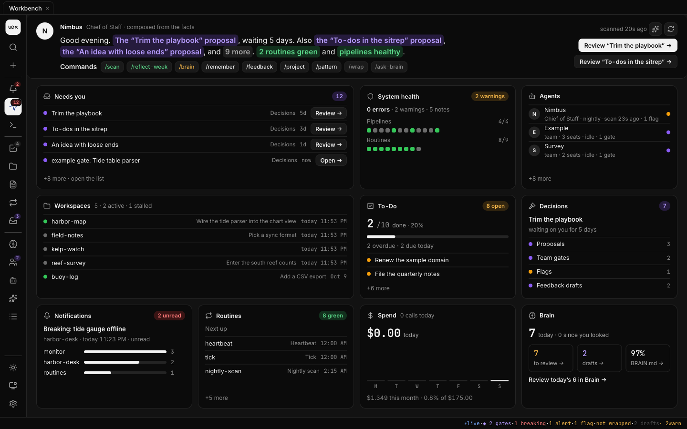
      <br /><sub><b>Dark.</b> Pulse in the dark theme. The app follows macOS's appearance, or App settings ▸ <b>Appearance</b> picks light or dark.</sub>
    </td>
  </tr>
</table>

<p align="center">
  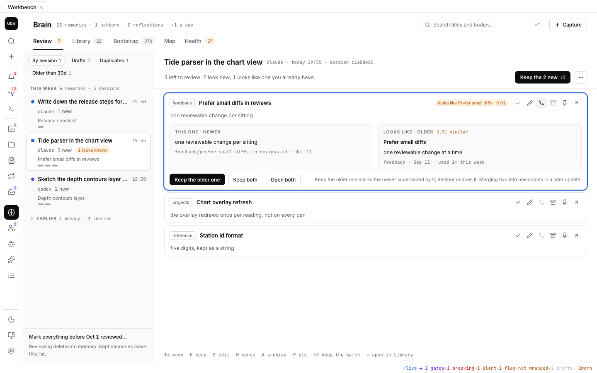
  <br /><sub><b>Brain, Review.</b> Memories by the session that wrote them, with the one a new memory looks like beside it.</sub>
</p>

<table>
  <tr>
    <td width="50%" valign="top">
      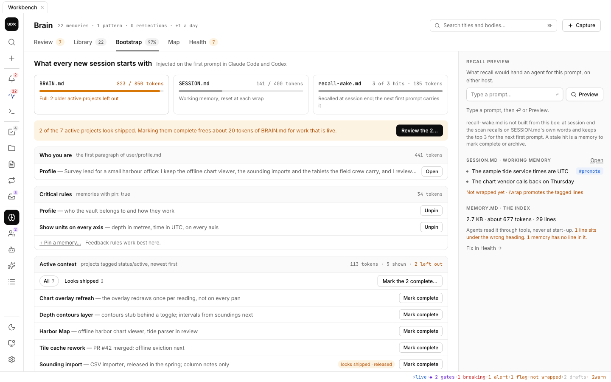
      <br /><sub><b>Brain, Bootstrap.</b> What every new session starts with, against its budgets: Unpin, Mark complete, the projects that look shipped, and a recall preview.</sub>
    </td>
    <td width="50%" valign="top">
      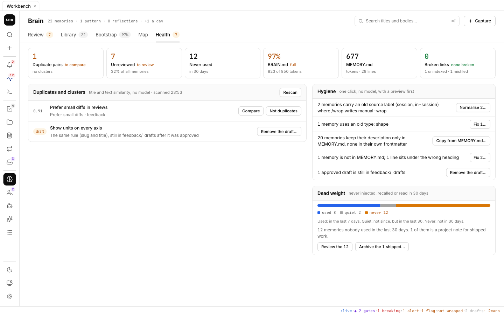
      <br /><sub><b>Brain, Health.</b> Duplicates, one-click hygiene fixes with a dry run first, and the memories nothing has used.</sub>
    </td>
  </tr>
</table>

<p align="center">
  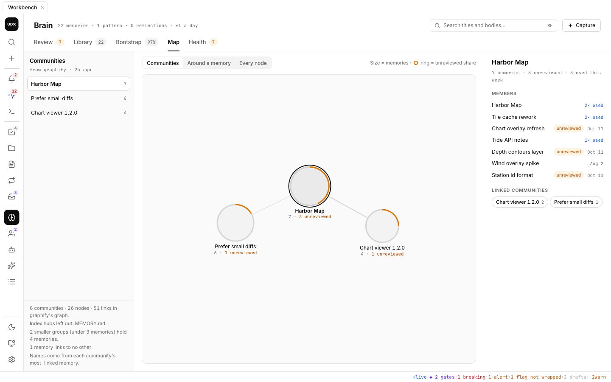
  <br /><sub><b>Brain, Map.</b> Your memories' communities in the knowledge graph, each named by its most-linked memory.</sub>
</p>

<p align="center"></p>

<a name="your-first-session"></a>
##  Your first session

Run `claude` in any directory and ask it *what do you know about me?* The first prompt arrives with `<brain-context>` (and your agent's `<persona>`). When you are done, `/wrap` extracts memories into `<vault>/brain/memory/` and adds a line to `MEMORY.md`. In a later session, *use the agenticos recall tool to search for …* answers from your own notes.

Then say `sitrep` for a one-action briefing on where your work stands, and `review persona flags` to walk through anything your agent has flagged or proposed. What it does between those two sentences — the hourly beat, the nightly reflect, the watchdog, the proposals protocol and how a class of change earns the right to apply itself — is the section below.

<p align="center"></p>

<a name="chief-of-staff"></a>
##  The Chief of Staff

Installed by default, and the part of the Workbench least like a tool: a **named agent with one job
description, a memory of its own decisions, and a contract about what it may change without asking.**
You interview it once during the install (step 7 above). After that it rides along on every prompt
and works on a schedule whether or not you are at the keyboard.

This repository ships the machinery only. Its identity, state, playbook, journal, proposals and
ledger are generated in your vault and never leave your machine — `agenticos.json` does not even
record its name.

### The interview

`aos init`, and `aos persona` at any time, ask seven questions: its **name**, how it should
**address you**, its **voice** in one line, **what to watch** most, and the **model**, **effort**
and **schedule** for its duties. The duties run on a hosted model, `claude-opus-5-5` on Claude Code
by default; with Codex enabled as a host there is an eighth question, the **Codex model**
(`gpt-6-sol` by default, stored as `persona.codexModel`), and a Codex-only machine is asked only
that one. The hourly check runs on this Mac's local model (below). The answers are kept in `<vault>/persona/answers.json`, so `aos persona`
re-runs prefilled and `aos persona rename <name>` re-renders every template. Where stdin is not a
terminal: `aos init --persona-json answers.json` or `aos persona --persona-json answers.json`.
`aos persona --yes` only re-applies the answers already in `persona/answers.json`; with none
stored, it writes nothing and exits 1.

### What rides along on every prompt

The `UserPromptSubmit` hook prepends a `<persona>` block ahead of the brain context: `IDENTITY.md`
(who it is, its five prime directives, its model policy, its self-modification contract) and
`STATE.md` (the current sitrep, open flags, pending proposals, the last duty runs), plus the morning
sitrep while it is under 18 hours old. The agent that answers you in a fresh terminal already knows
what it flagged at 22:00 last night.

`aos persona off` writes `persona/DISABLED` — no injection, no duties, nothing deleted.

### Its duties

Each duty is a file: `brain/routines/<slug>.md`, with its cron line in frontmatter. The tick and
the daily reflect also set their own budget cap (`budgetUsd`) and tool allowlist (`tools`) there
(for the tick, those of the duty its local triage wakes).
Monitor, sitrep and reflect use `persona.perDutyUsd` (2.00 by default) and the runner's default
allowlist; add `budgetUsd` or `tools` to any duty file to override them. Change a cadence by
editing the file and running `aos routines sync`.

| Duty | Cadence | Cap (USD) | What it does |
|---|---|---|---|
| **tick** | hourly | 0.50 | Local triage, then the hosted beat, read-only. `tick.js --triage` compares a signature of what can matter — a routine that failed or went missing (never run times), new commits in tracked repos, corrections, proposals, open flags, inbox alerts — with the last one; unchanged, it stops with no model call at all. A real change goes to the local model, which decides whether it merits a run and journals why (with the local model down, any real change does). The run queues what changed into `persona/queue.jsonl`. |
| **reflect-daily** | daily 22:00 | 0.50 | Drains that queue. Reads one evidence pack — the queue by type, the outcome ledger summary, each duty's fail streak, spend, the week's feedback and sessions — and files **at most two** proposals. Skipped when the queue is empty and today already drained; brought forward by the tick when the queue fills up. |
| **monitor** | daily 13:00 | 2.00 | Duty health, vault drift, unfinished work, pending review counts; prepares one safe fix. |
| **sitrep** | weekdays 07:45 | 2.00 | One page of where your work stands, leading with exactly **one** recommended action → `brain/_index/sitrep.md` and today's daily note. |
| **reflect** | Sunday 18:00 | 2.00 | The long form, over 28 days: curates the playbook, promotes repeated corrections to feedback memories, writes the weekly reflection. |
| **heartbeat** | every 30 min | — | Not a duty and never calls a model: `watchdog.js` projects every schedule forward and flags a duty that missed its window. |

Duties run headless with `AOS_HEADLESS=1`, so your own hooks never fire inside one — through
`claude -p --model claude-opus-5-5`, or `codex exec -m gpt-6-sol` on a Codex-only machine. With both
hosts, a duty that cannot start on its host (CLI missing or signed out) runs on the other host's
model instead (`persona.failover`); with no host able to start it, it is skipped and flagged once a
day, never failed. Every run is ledgered to `brain/_index/provider-spend.jsonl`; once today's duty
rows on both hosts together reach `persona.perDayUsd` (6.00) the rest of the day is skipped on both,
journalled and exit 0. **A duty never runs `git commit`** — anything it
edits beyond its own state stays in the working tree for you to read.

### Why the heartbeat exists

The duty runner can only record a failure for a run it was started for, so a scheduler that dies
takes the failure reporting down with it. The watchdog closes that gap from outside: it runs as its
own routine *and* from the `SessionStart` hook (throttled to once per 30 minutes, silent), takes each
duty's last run from `brain/_index/routines.json`, projects its schedule forward, and calls anything
past `persona.watchdog.graceMinutes` (45, longer than a duty's own timeout) a **MISSED** duty.

A miss becomes one line under `## Flags` in `STATE.md` — which the next session reads in its
`<persona>` block — one OS notification, and a rose heartbeat pill in the HUD sidebar. It clears its
own line once the duty runs again, and never touches a flag you closed by hand.

### Nothing guarded changes without you

`IDENTITY.md`, the duty files and their routines, the persona scripts, the schedules, and anything
outside `persona/` are **guarded**. The agent changes them only by filing
`persona/proposals/<date>-<slug>.md` with a premise table and a `recheck` recipe — a command that
exits 0 for as long as the finding is still there. `review persona flags` re-runs every recipe before
asking you anything, applies an approval exactly as written, re-runs the recipe expecting the finding
to be gone, and commits one decision at a time.

Every outcome is appended to `persona/ledger.jsonl` — `filed`, `approved`, `rejected`,
`stale-dropped`, `auto-applied`, `verified`, `regressed`, `accepted`, `dismissed` — and both reflects
read `ledger.js summary` before proposing, so a rejected idea is never filed at you twice and a
regression counts as evidence against the fix that caused it. A proposal that is an idea rather than
a change it can apply (`kind: workflow` or `product`) gets different verbs: **Accept** appends its
What and Why to `persona/backlog.md`, **Dismiss** records the reason.

### The loop, and how autonomy is earned

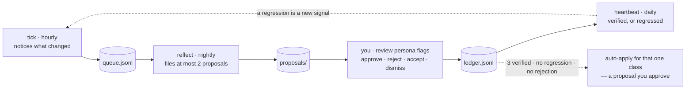

Every step is deterministic except the two model runs that judge. The last link is the interesting
one: a proposal may declare an `autoapply_class`, and once a class has `persona.autoapply.minVerified`
(3) verified approvals with no regression and no rejection, the next reflect proposes the exact new
`persona/autoapply.json` — a proposal you approve like any other. Only then is that *class* of change
applied without a question, and only after the tick has confirmed the finding two days running.
Until you approve one the whitelist is `[]` and the whole ladder is inert.

Nothing ever asks you to rate anything. The evidence is whether a recheck stays clean, whether the
duty metrics move, and whether your corrections on that topic stop.

### Talking to it

| | |
|---|---|
| *sitrep* · `/agenticos:persona-sitrep` | The morning page, rebuilt interactively when the cached one is stale. Internal work state only — it never fetches mail or calendars. |
| *review persona flags* · `/agenticos:persona-flag-closer` | One pass over everything pending your judgment. Collection and re-verification are deterministic Node (zero tokens); the conversation is spent only on decisions. |
| `aos persona` · `rename <name>` · `off` · `on` | Re-run the interview prefilled, rename the agent everywhere, flip the kill switch. |

The full reference — the file-by-file layout of `<vault>/persona/`, every env override, the caps and
the cron caveats — is [docs/chief-of-staff.md](docs/chief-of-staff.md).

<a name="everyday-commands"></a>
##  Everyday commands

**On the command line**

| Command | Does |
|---|---|
| `aos doctor` | Checks Node and uv (the install prerequisites), Ollama (a warning when missing), python3 while the cost module is on, the hosts (an info row when there is none yet), the pinned graphify and how old the vault graph is, `agenticos.json`, the vault layout and the recorded Node path (a warning for a versioned Homebrew Cellar path), the MCP handshake, which UniDeX app version last opened the vault (a warning until the app has run once), whether Ollama is answering or, under provider `local`, the local engine, its model and any session wraps waiting for it, plus one block per enabled host: the Claude login and plugin; the Codex login and plugin, how many of its hooks Codex trusts (a warning until you review them under `/hooks`) and its MCP server, or with direct wiring the hook entries, MCP registration and generated skills; and which host and model run the Chief of Staff's duties (with its failover host) and which CLI runs prompt routines. Exit 1 on any failure. |
| `aos status` | The resolved provider and why, today's spend against the caps, today's local model calls, and the pipeline ledger. |
| `aos provider local\|auto\|ollama\|claude\|codex\|none` | Choose who answers background work: `local` (a new install's default) keeps it on the model on this Mac and never spends; `auto` falls back to Claude, then Codex, when Ollama is away. |
| `aos local` · `aos local pull [model…]` · `aos local use <model>` | The local engine background work runs on: whether it answers, the models pulled, the one this Mac's memory calls for (`qwen3.5:4b` under 12 GB, else `qwen3.5:9b`), what runs now and today's local calls (`--json` too). `pull` downloads this Mac's model and the embedder (or the ones you name) through Ollama; `use` sets `local.model`. |
| `aos statusline install\|uninstall\|status\|preview` | The opt-in status line ([below](#the-status-line)): three lines in Claude Code, a footer preset in Codex, what needs you in both. `uninstall` puts back what you had. |
| `aos upgrade` | Updates the plugin from its marketplace — the GitHub clone, or the checkout you installed from with `--from-local`; on a machine with Codex and no Claude Code, the Codex marketplace — re-vendors the runtime from that same source, installs or refreshes the Codex plugin when that host is enabled (moving a direct install over to it), adds new config keys (your values win). Never touches memory, notes or persona. From 1.x it records what 2.0 asks once (`aos migrate`, below) and, in a terminal, asks the Go-local question. |
| `aos persona` · `aos persona on\|off\|rename <name>` | Re-run the interview, flip the kill switch, or rename your agent. |
| `aos config` · `aos config get <key>` · `aos config set <key> <value> [--dry-run]` · `aos config unset <key>` | Every setting in one list: its value, the file it comes from (`agenticos.json`, `brain/config.json` or the default) and a `*` where it differs from the default. `set` checks the value, writes it atomically to the file that actually wins, and runs what the change needs (clears the provider probe, pauses or resumes the Chief of Staff's duties), printing any step left as `next:`. `unset` goes back to the default. Install paths and hosts are read-only here; a background duty or routine can read settings but never change them. A daily cap of `0` means no spend. `aos doctor` flags unknown keys and bad values in either file. |
| `aos cost enable [--budget <usd>]` · `aos cost disable` | Opt in or out of session costing. |
| `aos graph` · `aos graph build [--semantic]\|on\|off\|semantic on\|off\|auto` | The vault graph: the pinned graphify, when it was last built, the semantic pass (who reads the notes, Claude, Codex or the local model on this Mac, last run, concepts, today's spend against its cap or "no spend" locally), counts, hubs and largest communities. `build` rebuilds it now; `build --semantic` runs the model pass now after a y/N; `off` stops scans rebuilding it; `semantic off\|on\|auto` controls the daily model pass. |
| `aos routines list\|sync\|run <slug>\|enable <slug>\|disable <slug>\|next` · `aos routines unschedule <slug>` · `aos routines hosts [--refresh]` · `aos routines import-cloud <file>` | The recurring actions in `brain/routines/`: list with cadence, next fire and health; render and load the OS schedules; run one now; flip one on or off; `unschedule` takes one routine's schedule out and leaves the others alone (a routine that turns itself off, such as the import digest, does it for you). A prompt routine's `engine: local\|claude\|codex` picks where it runs: the built-in local agent on this Mac (free, writing only where its `writes:` says) or that host's CLI. `hosts` lists, read-only, the routines each session host owns — the Codex app's Automations (read live from its local database) and the Claude Code cloud routines (a snapshot a session imports with `/routines cloud`). |
| `aos notify post --from <slug> --level breaking\|alert\|edition\|info --title <text> [--body-file <file>\|-] [--actions-json <file>\|-]` · `aos notify list [--unread]` · `aos notify read <id>\|--all` · `aos notify archive <id>` · `aos notify prune` | Post to and manage the vault's notifications (`brain/notifications/`), which the Workbench Notifications tab shows. Any agent, routine or duty on either host posts with `post`. Items are Markdown notes that are never edited after they are written; read and archived state lives in `state.json`. `breaking` and `alert` raise a desktop notification (`notifications.osAlert`), and a sender past `notifications.maxPerSenderPerHour` posts as `info`. Actions are allow-listed: `ask` runs a named skill in a new session, `react` records a +1/−1 the sender can read back. `prune` archives items older than `notifications.retentionDays`, and never deletes. |
| `aos team list\|status\|board\|tail <team>` · `aos team dispatch <team> <member> <item> --detach` · `aos team wait <team> <item> <member>` · `aos team gate approve\|redirect <team> <item> --expect <json>` · `aos team init` | Agent teams in `persona/teams/<team>/`: a lead moves work items across a board, dispatches headless seats into git worktrees on Claude Code or Codex (reviewers on the other provider), and you decide the gates, here or in the Workbench's Agent Teams tab. `aos team init` seeds an example team. |
| `aos skills [list [--all]]` · `aos skills sync [--dry-run]` · `aos skills exclude\|include\|reset <name>` | Every skill of both hosts with how to run it in each; share now instead of at session end; stop or resume sharing one skill (kept in `brain/config.json` `skills.exclude`); `reset` deletes a copy you edited by hand so the next sync writes it fresh. Sharing needs both hosts enabled; `skills.sync: false` turns it off. |
| `aos agents [list [--all]]` · `aos agents sync [--dry-run]` · `aos agents exclude\|include\|reset <name>` | Every agent of both hosts with how to reach it in each (Claude Code `@agent-<name>`, Codex by name); share now instead of at session end; stop or resume sharing one agent (kept in `brain/config.json` `agents.exclude`); `reset` deletes a copy you edited by hand so the next sync writes it fresh. Sharing needs both hosts enabled and rides the `skills-sync` hook; `agents.sync: false` turns it off. |
| `aos workspace list\|which [--cwd <path>]` · `aos workspace new <name> [--git] [--pin] [--empty]\|stubs <name> [--pin]` · `aos workspace adopt <path> --into <workspace>\|hide <path>\|unhide <path>` · `aos workspace archive\|restore\|draft <workspace>` · `aos workspace rename <workspace> <new-name>` · `aos workspace set <workspace> --set <json> [--expect <hash>] [--dry-run]` · `aos workspace adopt <path> [--name <slug>]` | The projects in `workspaces/`, and the verbs behind the Spaces tab's actions, which any Claude Code or Codex session can run too (each takes `--json`). `list` shows them with each host's session counts and the folders sessions ran in elsewhere; `which` names the workspace a folder belongs to (its own folder, its linked code folder, an alias or a git worktree of it). `new` creates one with `README.md`, `CLAUDE.md` and `AGENTS.md` (`--git` runs `git init`, `--pin` pins it, `--empty` leaves the folder empty for a `git clone`, and `stubs` adds the files after). `adopt --into` records an outside folder as an alias of a workspace, so its sessions count there, and moves nothing; `hide` and `unhide` take a folder off the outside list and back. `archive` moves a workspace into `workspaces/_archive/` with its file map and marks its project notes `status/archived`, and `restore` brings it back; `rename` moves the folder, its map and its Sessions threads and keeps the old name as an alias. `draft` proposes a summary, objectives and next step for `workspace.md` (one model call through the provider, or a labelled heuristic) and saves nothing; `set` writes `workspace.md` fields (`status`, `pinned`, `objectives`, `summary`, `next`, `repo`), and with `--expect` refuses a file that changed since that hash (`--dry-run` prints the file instead). Archive, restore and rename refuse a running team item or Sessions turn and a repository with linked git worktrees, and no verb moves a folder in a headless run. `adopt <path>` without `--into` still moves a project folder in. |
| `aos memory list` · `aos memory keep <path>…` · `aos memory set <path> --set <json> [--expect <hash>] [--dry-run] [--skip-brain-md]` · `aos memory archive\|restore <path>…` · `aos memory supersede <path> --by <path>` · `aos memory draft approve\|reject <slug>` · `aos memory notdup <path> <path>` · `aos memory fix <kind> [--dry-run] [--expect <hash>]` · `aos memory merge-draft <path>… [--estimate]` · `aos memory merge <path>… --into <json> --expect <hash>,…` · `aos memory unmerge <path> --expect <hash>` · `aos memory sweep [<path>…] [--estimate]` · `aos memory sweep dismiss <id>` | The memories in `brain/memory/`, and the verbs behind the Brain hub, which any Claude Code or Codex session can run too (each takes `--json`). `list` shows every memory with its status, pin, review state and a hash, the feedback drafts, and the counts; `keep` marks memories reviewed; `set` changes `pin`, `status` (`active`, `complete`, `paused`), the title (the heading and the `MEMORY.md` line; the file name stays) or the description, and with `--expect` refuses a file that changed since that hash (`--dry-run` prints the file instead; `--skip-brain-md` leaves the `BRAIN.md` rebuild to the caller, as Bootstrap's bulk Mark complete does). `archive` marks a memory `status/archived` and takes its `MEMORY.md` line out, so recall and `BRAIN.md` leave it out too; `supersede` does the same with `status/superseded` and a `superseded_by:` pointer to the memory that carries it now; `restore` undoes either. No memory is deleted. `draft approve\|reject` decides a feedback draft; `notdup` stops two memories being flagged as duplicates. `fix` repairs what Brain's Health finds, one kind at a time and on live memories only: `sources` relabels the old in-session sources (`session`, `in-session`, `wrap`) as `manual-wrap`; `types` turns the old frontmatter shape into `type: memory` and adds its `memory/<type>` tag (a status it lacks stays unset, so no old project lands in `BRAIN.md`'s Active context); `descriptions` copies a memory's `MEMORY.md` description into its own frontmatter; `index` adds a missing `MEMORY.md` line, moves one filed under another type's heading, and removes one to a missing file, one of an archived or superseded memory or a second copy, naming why; `drafts` removes a feedback draft left behind after its rule was approved (the same name and title as a live feedback memory). With `--dry-run` it prints the changes and their hash and writes nothing, and `--expect <hash>` makes a real run refuse, writing nothing, unless it would make exactly those changes; a real run writes a trail row per changed memory or draft, and one per memory whose `MEMORY.md` lines it removes, with each field's before and after, and a second run finds nothing to do. `merge-draft` drafts one memory from 2–6 with the background provider (the local model under provider `local`; under `auto` Ollama, else Claude Code, else Codex) and writes nothing; with no provider or at a cap it gives a draft made without a model and says why, and `--estimate` prices the call without making it: with `--json` it prints the cost, today's cap, the memory that will carry the merge (the oldest), each memory's hash and that no-model draft. `merge` writes a title, description and body over the oldest, which keeps its path, links and pins, supersedes the others by it and leaves one `MEMORY.md` line; `--expect` takes one hash per memory, in order, and a file that changed since refuses the merge, writing nothing. What each memory and `MEMORY.md` held before is kept in `brain/_index/memory-merges/` for 30 days, so `unmerge` puts it back, byte for byte where nothing changed since (a memory edited since gets its status and `MEMORY.md` line back, keeping the edit), as long as the merged memory has not changed since. `sweep` asks Claude Code or Codex (under provider `local`, the local model, in chunks it can hold) for merge, archive and retitle suggestions, each with its reason, over every memory or up to 50 named ones, and keeps them in `brain/_index/memory-sweep.json`; it applies none of them (each goes through the verbs above when you act on it), `--estimate` prices a run without making it, and `sweep dismiss <id>` hides a suggestion for good. An estimate makes no model call, not even Claude Code's daily sign-in check, and writes nothing. Pin, status and title changes, a merge or its undo, and a `types` or `index` fix rebuild `BRAIN.md`. |
| `aos cross-review preflight --host claude\|codex` | Whether the other provider can review from this host: each CLI's path, version and login (no model call), the roles, today's cross-review spend against `crossReview.perDayUsd`. |
| `aos import [--dry-run] [--from claude\|codex] [--since 90d\|all] [--only …] [--accept <json>]` | Bring your Claude Code and Codex history into the vault, from whatever each host left on disk, on the local model only: global `CLAUDE.md` / `AGENTS.md` as rules typed user, feedback or reference (one note per file without a local model), Claude Code's auto-memory with its types, both hosts' MCP servers listed (never their secrets, no host config written), project folders with 3+ sessions or recent ones proposed as workspaces (created only with `--accept`), and the last 90 days of sessions queued for the import-digest routine, which writes a `## Sessions` line into each day's daily note, a timeline per workspace and up to three memories per session, and turns itself off when done. Memories land in Brain ▸ Review as one batch per host, `reviewed: false`, after a duplicate check; a second run writes nothing twice. `--dry-run` writes nothing and prints what it would bring (`--json` too). |
| `aos hosts add claude\|codex` | Wire one more host into this install: refused unless its CLI is installed and signed in; enables it (the other host stays as it was), installs its plugin (or Codex's direct wiring), imports its instructions, memories and MCP servers, and re-renders the installed schedules. The first host on an install made without one also sets up the Chief of Staff, which waited for it: the interview in a terminal, otherwise the default answers (named Atlas, its duties on the chief role's model for that host, scheduled), which `aos persona` changes; an existing one is never touched. `aos import --from <host>` brings its session history. |
| `aos hosts status [--json]` | Each host as `aos hosts add` would find it: on or off in `agenticos.json`, its CLI and whether it is signed in (no model call), and what to do next. The app's Settings ▸ Hosts shows the same. |
| `aos migrate [local-first\|import] [--apply [--chief] \| --decline \| --undo \| --status]` | What an upgrade to 2.0 asks once (the app asks with its Go local card; `aos upgrade` asks on a terminal, else prints these). `local-first --apply` backs up what it changes, then sets `provider: local` and the AI switches (`ai.*`) to local in `agenticos.json` and `brain/config.json`, updates the hourly `tick.md` only when it is still the one a release shipped, and re-renders the schedules; `--chief` also moves the Chief of Staff to `claude-opus-5-5` / `gpt-6-sol`. `--decline` keeps your settings; `--undo` restores the backup (a setting you changed since is kept). An apply that stopped part way is finished by the next `--apply` on the same backup. `import --apply` runs `aos import`. No routine of yours is touched. |
| `aos mcp copy <name> --to claude\|codex [--dry-run] [--expect <hash>]` | Make one MCP server of one host available on the other, through that host's own CLI (`claude mcp add-json --scope user` or `codex mcp add`), reading the server's full config from the host that has it at the moment you run it. `--dry-run` writes nothing in the vault or a host's config and prints the command with environment and header values, URL credentials and queries and arguments named or shaped like secrets hidden (one it does not recognise shows as written), and a keyed hash; `--expect <hash>` makes the real run refuse anything other than what the dry run showed. A real run first backs the target's config file up in `~/.local/share/unidex/backups/mcp/`, outside the vault. A remote (http or sse) server goes to Claude Code only; a server turned off on its host is not copied. The Workbench's Skills ▸ MCP servers runs it per server, on your click. |
| `aos uninstall [--keep-vault]` · `aos uninstall --host codex` | Removes the Claude Code and Codex plugins (or the direct Codex wiring: hook entries, MCP registration, generated skills), the schedules, the symlink and `agenticos.json`. The vault is deleted only if you type its path back. `--host claude\|codex` unwires one host and keeps everything else. |

The main runtime scripts are also reachable as `aos <name>`: `aos scan-vault`, `aos recall "<query>"`, `aos build-brain-md`, and so on. A name the launcher does not know exits with `aos: unknown script <name>`.

**Inside a session** (Claude Code: `/name` · Codex CLI: `$agenticos:name`, or `$name` with direct wiring)

| Command | Does |
|---|---|
| `/remember <text>` | Append a note to this session's working memory; tag it `#promote` to make it permanent at `/wrap`. |
| `/todo <text>` | Add a todo to `TODO.md`: "by Friday" becomes a 📅 due date, "urgent" a ⏫ priority, `#tags` stay; the Workbench To-Do tab shows it. In a session that runs in a workspace (its folder, a worktree of it or its linked code folder, as `aos workspace which` answers on both hosts) the line is also tagged `#ws/<slug>`, so it shows under that workspace's Linked to-dos in Spaces. |
| `/propose <idea>` | File a proposal in `persona/proposals/` in the standard format (title, What / Why / Risk / Premises), render its HTML page and link it; the Workbench Proposals tab lists it and "review persona flags" decides it. Filed from a workspace, it records `workspace: <name>` and shows under that workspace's Linked proposals in Spaces. |
| `/notifications [list\|read <id>\|archive <id>\|post …]` | Your unread notifications from agents and routines, newest first; mark them read or archive them. It also shows an agent how to post one with `aos notify post`. The Workbench Notifications tab shows the same items. |
| `/team [list\|status <team>\|board <team>\|gate approve\|redirect <team> <item>]` | Your agent teams: boards, pending gates first, live runs; records a gate you decide in the session, and tells a lead and its seats how to dispatch and post. |
| `/wrap` | Session-end protocol: promote `#promote` items, extract this session's memories, summarise into today's daily note. |
| `/feedback` · `/pattern` · `/project` | Capture a feedback rule, a decision pattern, or project context as a permanent memory. `/project` run from a workspace records `workspace: <name>` in the note, which links it to that workspace in Spaces (and Archive there marks it `status/archived`). |
| `/brain` · `/scan` | Show the current brain state; refresh the dashboard caches (full scan, `BRAIN.md`, recall index). |
| `/ask-brain <question>` | Assemble the relevant memories and answer from them. |
| `/standup` · `/reflect-week` · `/consolidate-memory` · `/compress` | A Did/Doing/Blockers standup, a weekly reflection, a memory-merge draft, a distillate of a large file. The context is assembled locally; Claude answers in your own session. |
| `/cost` · `/aos` | Cost completed sessions from their transcripts (cost module only); maintenance from inside a session — doctor, status, provider, persona, config (`/aos config set telemetry.redact true`). |
| `/cross-review` · `/handoff` | The other provider reviews your plan before you build (Claude Code and Codex review each other); optionally it builds, and the provider that did not build inspects the diff. `handoff` recommends who should handle a task and runs one scoped handoff to the model you pick. Every child session is read-only unless it builds, unsaved, kept out of your memory pipeline, and on its own budget (`crossReview.perDayUsd`). With only one CLI, a clearly labelled same-provider review is offered. Adapted from [claudex-loop](https://github.com/chaseai-yt/claudex-loop). |
| `/skills [list\|sync\|exclude <name>\|include <name>\|reset <name>]` | The same verbs as `aos skills`, from inside a session. |
| `/agenticos:agents [list\|sync\|exclude <name>\|include <name>\|reset <name>]` | The same verbs as `aos agents`, from inside a session. In Claude Code it takes the `agenticos:` prefix because the bare `/agents` is Claude Code's own agent manager; Codex: `$agenticos:agents`. |
| `/routines [list\|sync\|run <slug>\|enable\|disable\|next\|hosts\|cloud]` | The same verbs as `aos routines`, from inside a session; `cloud` fetches your Claude Code cloud routines (the in-session `RemoteTrigger` tool) and imports the snapshot. |

Skills answer to plain phrases: *sitrep* (or `/agenticos:persona-sitrep`), *review persona flags* (`/agenticos:persona-flag-closer`), *cross-review this plan* (`/agenticos:cross-review`), *who should handle this* (`/agenticos:handoff`), *how is X related to Y* (`/agenticos:graph`), plus `recall`, `wrap`, `feedback-review` and `cost`. Under Codex every one of these is a skill of the agenticos plugin (`$agenticos:persona-sitrep`, `$agenticos:recall`, …) and the MCP tools are `mcp__agenticos__<tool>`.

### Staying up to date

The app updates itself: it downloads a new version in the background and installs it when you quit, or at once from **Restart to Update** (the status bar, and UniDeX ▸ Check for Updates…). It then offers to update the runtime in your vault; `aos upgrade` does the same from a terminal and pulls the newest plugins. The first launch after an update shows, one dialog at a time, the runtime update, anything the release asks you once (2.0's **Go local** card and **Import** sheet, [docs/migrating-to-2.0.md](docs/migrating-to-2.0.md)) and **What's new** in it, each with **Show me**; Help ▸ What's new keeps the list. What each version changed, and anything you need to do after upgrading (its **Upgrading** notes), is in [CHANGELOG.md](CHANGELOG.md) and on the release page. To be told when there is one, the runtime writes a one-line
fragment that is either empty or the update notice, at `<vault>/brain/_index/update-line.txt`. With
the default vault (`~/AgenticOS`, unless you passed `--vault` to `aos init`):

```sh
cat "$HOME/AgenticOS/brain/_index/update-line.txt" 2>/dev/null
```

If you used a different vault, `aos update-status --statusline` prints the same fragment without you
having to hardcode the path:

```sh
aos update-status --statusline 2>/dev/null
```

Add either line to your own status line script and it contributes nothing until an update exists.
Both read a file (the second through one short-lived `aos` process) and never touch the network, so
they cost nothing per render. UniDeX never installs a status line or claims the slot on its own:
only `aos statusline install` does, when you run it, and `aos upgrade` only re-points one you
installed at the new runtime ([The status line](#the-status-line)).

You are also told once at the start of every session. The check itself runs at most once a day, in a
detached process, so nothing ever waits on GitHub.

```sh
aos update-status                 # what is installed, what is available
aos update-status --snooze 7d     # silence this version for a week
aos update-status --off           # stop checking entirely
aos update-check                  # check right now
```

### The status line

`aos statusline install` gives Claude Code a three-line status line and Codex a footer preset. It is
opt-in: `aos init` never installs it, and `aos upgrade` only re-points one you already installed (and
still hold) at the new runtime.

```
Opus 5.5 (1M) ·high ·think │ Writing the spec │ my-project ⎇ feat/x* │ #63 review
████░░░░░░ 46% │ 5h 24% · 7d 41% │ $3.42 │ cache 91% · 42m │ +156/-23
◆ 2 gates · 1 alert · 1 flag │ ▶ woz execute site-01 │ duties $4.80/$6 │ ↑ 1.1.0
```

- The first two lines are the session: model and effort, what you are working on (the task in progress, else a
  GSD project's phase), the branch and PR, then context, rate limits, cost, prompt cache and lines changed.
- The third line is UniDeX's and appears only when something needs you: gates waiting on you, unread breaking
  news and alerts, open Chief of Staff flags, a live agent-team run, the spend nearest its daily cap (from half of
  it), an update, a background provider that fell to none, an unwrapped session. In a terminal with OSC 8 links,
  each opens the Workbench tab that handles it (an `agenticos://` link the app registers). The app's status bar shows
  the same.
- The status line you had keeps running: install records it and runs it with the same input on every refresh, so a
  tool that writes files from its status line still works. `--chain-output` also shows its first line (above ours,
  or below with `aos config set statusline.chainPosition bottom`), and `aos statusline uninstall` puts it back
  (byte for byte when nothing else in the file changed).
- If another installer takes the slot later, `aos doctor` and the next session start say so, and
  `aos statusline install` takes it back and chains the newcomer.
- Claude Code subagents get their own rows: model, effort, context used, age.
- Codex runs no status line command, so install writes a preset of its built-in items into `config.toml`
  (never over a `status_line` you set, unless you pass `--force`), and what needs you is printed at session start.
- Settings (⚙ Settings → Status line, or `aos config set`): `statusline.segments`, `statusline.links`,
  `statusline.chainPosition`, `statusline.subagents`, `statusline.refreshSeconds`, `statusline.codexItems`.

<p align="center"></p>

<a name="how-it-works"></a>
##  How it works

<p align="center"></p>

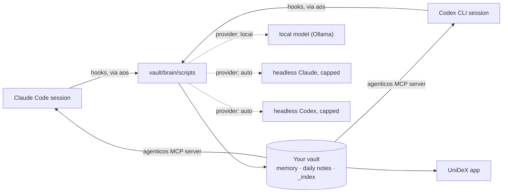

- **Hosts.** A session runs under Claude Code or Codex CLI, and both can share one vault. The runtime is the same; only the wiring differs: Claude Code loads `plugin/`, Codex loads `codex-plugin/`, and both come from the same marketplace. `codex-plugin/` is generated from `plugin/` (`npm run build:codex-plugin`, checked by the tests), so the hooks, the MCP server and the commands stay in lockstep across the two hosts. A Codex CLI without plugin support gets the same pieces written into its own config instead. The three modes are equivalent: **Claude Code only**, **Codex only**, or **both on one vault**. A hook learns which host fired it from one environment variable the wiring sets; the MCP server's entry in each plugin names its host too; where nothing sets it (an `aos` verb run inside a session), the runtime works it out from the session transcript's path, then from the config when only one host is enabled. Which memories reach a session (injected at its start, returned by `recall`, read with `memory_read`) is logged by path, with its host, in `brain/_index/memory-usage.jsonl` (on by default with telemetry; `telemetry.enabled: false` turns both off); no prompt or query is kept. One transcript reader understands both CLIs' session logs, and telemetry records the host and model of every run.
- **Hooks.** Both hosts fire hooks for session start, every prompt, every tool use, stop and session end. Each one runs `aos <script>` inside your vault: inject context, update working memory, stream telemetry, write the heartbeat, cost the session, wrap it, rescan. Under Codex the conventions file is injected at every session start too, since `AGENTS.md` cannot include it. Codex fires session end late in its TUI (thread close, or 30 minutes idle) and, depending on the version, not at all under `codex exec` (0.144 did not, 0.155 does), so a reconcile pass on every session start and stop finishes any run idle for `telemetry.staleAfterMinutes`: it closes the telemetry, costs it and wraps it exactly as session end would have. A Claude Code terminal killed mid-session is healed the same way.
- **Runners.** Persona duties, on the Chief of Staff's model for each host (`claude-opus-5-5`, `gpt-6-sol`), and `prompt` routines without an `engine:` run through `claude -p` when Claude Code is wired and installed, otherwise through `codex exec` (workspace-write sandbox, our hooks off, the spend estimated from its token counts since Codex has no budget flag; the daily caps still gate every start). `persona.runner` and `routines.runner` pin one; `aos doctor` shows the choice. A routine with `engine: local` runs on the built-in local agent instead: this Mac's model with read, list, search, write (only where its `writes:` says) and notify tools, no spend. The Sessions tab's Vault chat answers through the reasoner (below), so it works without the `claude` CLI too, on Codex or the local workhorse; its menu can also send one question to a chosen host and model (`claude -p`, or `ask.js --local --host=codex`), on the reasoner's caps with no fallback to another provider.
- **The vault** is an ordinary folder of Markdown that is the agent's second brain, and what the UniDeX app shows. Its `workspaces/` folder is the home for project working directories of both hosts: a project is anything with a `README.md`, `CLAUDE.md`, `AGENTS.md`, `STATUS.md`, `PLAN.md` or `.git`. Every scan reads each host's transcripts and credits a session to the workspace it started in (the folder, its linked code folder or an alias in its `workspace.md`), to the workspace of the team seat or git worktree it ran in, or, for a session started at the vault root, to the workspace whose files it touched most; the counts cover the last 30 days (`workspaces.idleDays`) on both hosts. Folders whose name starts with `_`, such as `_archive` and `_worktrees`, are hidden from Spaces and left out of Pulse's counts. The Spaces tab lists whatever ran outside a workspace, leaving out home, temp, scratch and job folders and each host's config folder. A workspace's `workspace.md` frontmatter travels with the folder and is what Spaces, and either host's sessions through `aos workspace set`, change: `pinned`, `status` (`active`, `paused` or `done`, which wins over the automatic word), `repo` (its linked code folder) and `aliases` (folders whose sessions count for it: one adopted from the outside list, or its own name before a rename). Archiving moves a workspace into `workspaces/_archive/` with `archived:` set; its sessions stay credited and its Sessions threads stay listed, read-only until it is restored. `AGENTICOS.md` documents the layout and the three-file rule: `MEMORY.md` is the index, `brain/memory/<type>/` holds the content, `brain/_index/BRAIN.md` is the compiled bootstrap injected on the first turn.
- **Providers.** `local`, a new install's default, runs background work on the local engine (Ollama, or an OpenAI-compatible server) with a model sized to the Mac's memory (`qwen3.5:4b` under 12 GB, else `qwen3.5:9b`), counts each call in `brain/_index/local-usage.json` and spends nothing. It is ready only when the model is downloaded (`aos local pull`); while it cannot answer, session wraps wait in a queue and run when it is back, summaries, insights and file maps use their heuristics, the briefing shows the facts alone, and recall uses keyword search; nothing goes to Claude or Codex unless you turn on `local.hostedFallback`. `auto` picks Ollama when it answers, otherwise headless Claude (`claude -p --model haiku`, capped per call and per day, every call ledgered), otherwise headless Codex when Codex is a wired host (`codex exec`, read-only, hooks off, spend estimated from its token counts), otherwise `none`. Under `none` nothing calls a model in the background; summaries are heuristic and `/wrap` extracts memories inside your own session through the `wrap_session` tool. One role is the exception: the **reasoner** behind `/ask-brain --local`, `/reflect-week`, `/consolidate-memory` and the Sessions tab's Vault chat is a hosted model whatever `auto` resolved: Claude (`reasoner.model`, default `claude-opus-5`) when Claude Code is a host and logged in, otherwise Codex when it is a host and logged in (`reasoner.codexModel`, else `codex.model`); an explicit `provider: codex` puts Codex first. It has its own per-call and per-day caps, and falls back to the local workhorse when neither is available or its daily cap is reached. Brain's two model calls each take one of these routes: Merge with AI drafts through the background provider, and the consolidation sweep goes the reasoner's way (Claude, else Codex) under the reasoner's caps but with the background models (`claude.model`, or `codex.model` at `codex.effort`); where nobody hosted can answer and Ollama is up, the sweep runs there. **Under provider `local`** each reasoner feature follows its own switch, `ai.chat` (Vault chat), `ai.ask` (Ask brain), `ai.reflectWeek` and `ai.consolidate`: `local` (the default) runs it on the local model, even with a host signed in, `host` keeps the hosted reasoner above; the sweep and Merge with AI run on the local model too (the sweep sends brain hub's duplicates and clusters in chunks the model can hold). With the local model down, nothing goes to a host unasked: a button offers "Run once on Claude Code/Codex" with the cap it counts against (`--host claude|codex` on `ask.js`, `reflect-week.js`, `consolidate-memory.js` and `aos memory merge-draft|sweep`).
- **The graph.** Every scan ends with a `graph-build` stage: `graphify update <vault>` writes `brain/graphify-out/graph.json`, a structural graph of pages, headings and links clustered into communities, in a second or two and with no model. It skips what `.graphifyignore` and the vault's `.gitignore` list (workspaces, the runtime, caches, templates). graphify is pinned (`aos upgrade` moves it only with a release), lives in a tool dir of its own, and never sees an API key. At most once a day a second stage, `graph-semantic`, runs `graphify extract` in the background: only new or changed notes go to Claude (`claude.model`, through a shim that gives every call the same isolation as the other headless calls — no tools, no hooks, no thinking, `--max-budget-usd`) or, where Codex is the host, to `codex exec` behind the same shim (read-only, no hooks, low effort, spend estimated), which adds concept nodes and `INFERRED` edges. It has its own daily cap, `graph.semantic.perDayUsd` ($1), separate from the hooks'; at the cap the remaining notes wait for the next run. `graph.semantic.enabled` is `auto`: on, unless the provider is `none`. Under provider `local` (or `ollama`) the pass runs on graphify's own local backend at your engine's address instead, one chunk at a time, with no spend, and waits while the Mac is on battery (`local.onBattery`). After the graph build, the scan's `brain-hub` stage distils the graph for the Brain tab's Map into `brain/_index/brain-map.json`: graphify's own communities holding at least `memory.mapMin` memories (8), with the index pages (`MEMORY.md`, the MOCs, `BRAIN.md`) left out, each named by its most-linked memory, the links between them and up to 12 neighbours per memory, with no model call.
- **The Chief of Staff** is built out of the same two pieces: its duties are routine files that the runner starts, and its watchdog is a routine that never calls a model. What it may change on its own is a file contract, not a code path — see [The Chief of Staff](#chief-of-staff).
- **The HUD** reads the same files: the pipeline ledger, live agent runs, the memory graph, provider state, spend, and your agent's identity and flags.

<a name="privacy"></a>
##  Privacy

- Your vault stays on your machine. Background calls go to your local Ollama or to your own Claude or Codex login; the cost analyzer runs with `--no-api`.
- Telemetry redaction is on by default.
- The vault graph's structural pass is local: it calls no model and runs without any API key in its environment. The daily semantic pass sends the text of new or changed notes to Claude, or to Codex where Codex is the host, on your own login, under its own $1/day cap; under provider `local` or `ollama` it runs on the local model instead (graphify's own local backend at your engine's address: nothing leaves the Mac, no spend, and it waits while the Mac is on battery); it is off when the provider is `none`, and `aos graph semantic off` turns it off anywhere.
- This repository ships machinery, not content: the Chief of Staff's identity, state and playbook are generated for you at install. A privacy gate (`npm run gate`) runs in CI against a public list of generic terms plus the maintainer's private list, which is kept out of the repository and reaches CI as a secret, and gitleaks checks every pushed commit, so nothing personal can land here.

<a name="repository-layout"></a>
##  Repository layout

```
brain/scripts      the runtime that gets vendored into your vault (hooks, collectors, recall, MCP server, persona)
cli                the installer and the aos subcommands (persona, schedule, routines, cost, the Codex host) + two install rehearsals
plugin             the Claude Code plugin: hooks.json, .mcp.json, bin/aos, 21 commands, 9 skills (also the source of codex-plugin)
codex-plugin       the Codex plugin, generated from plugin/ by npm run build:codex-plugin: hooks.json, .mcp.json, bin/aos, 28 skills
obsidian-plugin    the Workbench HUD's source (TypeScript), which the app compiles (the folder keeps its old name)
app                the Workbench as a macOS app: the HUD above in an Electron window (its own lockfile; see app/README.md)
vault-template     the seed vault (AGENTICOS.md, MEMORY.md, brain/ incl. the three duty routines, persona templates incl. the heartbeat watchdog, hourly tick and nightly reflect routines)
extras             the launchd schedule template, the cost analyzer, optional Ollama helpers
tools              export-from-vault, the privacy gate, and the brand-asset generator behind docs/assets
docs               install, migrating to 2.0 and to 1.0, chief of staff, cost, the app's smoke checklist, the release acceptance runbook,
                   and superpowers/ — the design spec and plan behind each shipped feature
```

<a name="development"></a>
##  Development

```sh
npm test                 # every suite: tools + cli, brain/scripts, obsidian-plugin
npm run test:one -- <file>…   # one or a few test files, each with its suite's setup (a temp vault, config and host homes)
npm run gate             # the privacy gate — fails on any forbidden term
npm run lint             # eslint over the JavaScript
npm run lint:sh          # shellcheck over every tracked shell script (brew/apt install shellcheck)
npm run typecheck        # tsc over the HUD's TypeScript
cd extras/cost && python3 -m unittest      # the cost analyzer's tests
sh cli/rehearsal/first-run.sh              # a complete install in a temp HOME with a fake claude (what CI runs)
sh cli/rehearsal/codex-host.sh             # a Codex-only machine: direct wiring, then the upgrade to the Codex plugin; hooks and MCP run for real
npm run build:codex-plugin                 # regenerate codex-plugin/ after changing plugin/ (the tests fail until you do)
(cd app && npm ci && npm run test:e2e)     # the app: see app/README.md (macOS)
(cd app && npm run screens)                # retake the README screenshots on a demo vault
node tools/brand-assets.js                 # regenerate the brand assets under docs/assets
```

The suites never see your shell's `AOS_*`, `BRAIN_*`, `CLAUDE*` or `CODEX_*` variables (`tools/test-env.js` clears them once per run), and CI runs them again in UTC+14 and UTC−11 with those variables exported, so a test that leans on your time zone or your setup fails there. Run a single file with `npm run test:one -- <file>`, never a bare `node --test <file>`: without that setup a test would resolve your own vault and config, so the vault, config and host-folder lookups refuse to run under the test runner without it (`brain/scripts/lib/test-guard.js`). `brain/scripts/test/live/` needs a running Ollama and is excluded from `npm test`. The Workbench's manual checklist is `docs/app-smoke.md`; the per-release acceptance runbook is `docs/acceptance.md`.

A user-visible change gets a line under `## [Unreleased]` in `CHANGELOG.md`, and each **Added** and **Changed** line ends with the guided-tour step that shows it, `<!-- tour: <chapter>[.<step>] -->` (ids from `obsidian-plugin/src/tour/steps.json`; several comma-separated), or says why none does, `<!-- no-tour: <reason> -->`. `node tools/changelog.js check current` (CI's lint job) fails a line with neither, an unknown id or an empty reason; GitHub hides the markers and the release notes drop them. A release also needs its What's new entry in `obsidian-plugin/src/tour/whatsnew.json` before `npm run version:bump`, or the bump refuses (`docs/app-smoke.md`, Release procedure).

<a name="uninstall"></a>
##  Uninstall

```sh
aos uninstall --keep-vault     # remove both plugins (or the direct Codex wiring), schedules, symlink, the graphify tool dir and agenticos.json; keep the vault
aos uninstall                  # additionally delete the vault, after you type its path back
aos uninstall --host codex     # unwire only the Codex host (its plugin and marketplace, or the direct wiring); keep everything else
```

To remove the app too, quit it and drag **UniDeX** from Applications to the Trash; its own settings are in `~/Library/Application Support/AgenticOS Workbench`.

`~/.claude` and `~/.codex` are left exactly as they were (a `hooks.json` that held only our entries is removed; one with your own entries keeps them). No form of `aos uninstall` edits your `CLAUDE.md`: remove the `@<vault>/AGENTICOS.md` line yourself (you added it from the installer's checklist, or the app's wizard added it at your request). The vault is never deleted when it is your home directory or a Claude config directory.

<a name="docs"></a>
##  Docs

| | |
|---|---|
| [docs/install.md](docs/install.md) | The app's setup wizard step by step, the terminal install, every installer step and flag, bringing in your history, hosts, providers (local first) and spend caps, the orphan sweep, daily-note layout. |
| [docs/migrating-to-2.0.md](docs/migrating-to-2.0.md) | What an install from 1.x sees after updating to 2.0, what never changes without asking, and how to undo it. |
| [docs/migrating-to-1.0.md](docs/migrating-to-1.0.md) | Moving an install from before 1.0 off Obsidian and onto the app. |
| [docs/chief-of-staff.md](docs/chief-of-staff.md) | The interview, the persona layout, duties as routine files and their schedules, the heartbeat watchdog, proposals and their outcome ledger, the kill switch, caps. |
| [docs/cost.md](docs/cost.md) | The cost module: enabling it, what it records, the budget, CI. |
| [docs/app-smoke.md](docs/app-smoke.md) | The Workbench's manual smoke checklist, and the release procedure. |
| [app/README.md](app/README.md) | Running, testing and building the app from a checkout. |
| [docs/acceptance.md](docs/acceptance.md) | The release acceptance runbook, run on a fresh macOS account. |
| [extras/ollama/README.md](extras/ollama/README.md) | Running Ollama as a supervised service (optional; the Ollama app runs itself), pulling the models by hand. |

<p align="center"></p>

<a name="credits"></a>
##  Credits

Created by **Zach Zoretich** — [@zzoretich](https://github.com/zzoretich).

Built with [Claude Code](https://claude.com/claude-code). The brand assets under `docs/assets/` are
generated, not hand-drawn: `node tools/brand-assets.js` rebuilds all 23 from one palette in
[tools/brand-assets.js](tools/brand-assets.js), and `tools/brand-assets.test.js` holds them to being
inert, on-palette and byte-stable.

`cross-review` and `handoff` are adapted from [claudex-loop](https://github.com/chaseai-yt/claudex-loop) by Chase AI, and
the glossary and ADR formats inside `cross-review` from [Matt Pocock's skills](https://github.com/mattpocock/skills),
both under the MIT License; each skill's `THIRD-PARTY-NOTICES.md` carries the notice and what changed.

Issues and pull requests are welcome — the project stays contributor-owned under the license below.

<a name="license"></a>
##  License

[MIT](LICENSE) — AgenticOS Workbench contributors.

<p align="center"></p>
