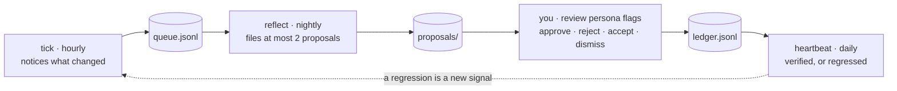
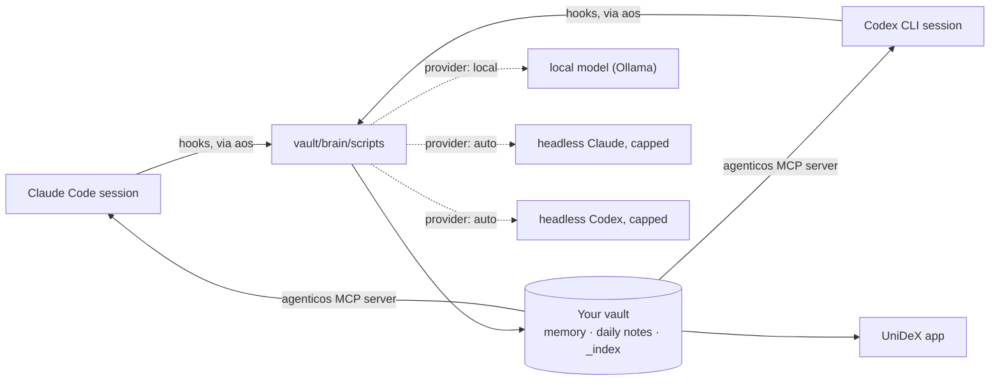

<p align="center">
  
</p>

<p align="center">
  <strong>Claude Code, Codex and local models building software together, run by a Chief of Staff that learns how you work.</strong><br />
  Plan · build · review · ship, on Claude Code, Codex or both, with a macOS app over all of it.
</p>

<p align="center">
  <a href="https://github.com/zzoretich/UniDeX-Agent-Harness/releases/latest"></a>
  <a href="https://github.com/zzoretich/UniDeX-Agent-Harness/actions/workflows/ci.yml"></a>
  
  
  
  <a href="LICENSE"></a>
</p>

<p align="center">
  <a href="#download">Download</a> ·
  <a href="#overview">Overview</a> ·
  <a href="#install">Install</a> ·
  <a href="#using-it">Using it</a> ·
  <a href="#chief-of-staff">Chief of Staff</a> ·
  <a href="#how-it-works">How it works</a> ·
  <a href="#docs">Docs &amp; credits</a> ·
  <a href="CONTRIBUTING.md">Contributing</a>
</p>

<p align="center"></p>

UniDeX is an agent-driven development harness: Claude Code, Codex and local models work on your projects together throughout the development lifecycle. One model plans and the other reviews the plan, one builds and the other inspects the diff, and a model on your Mac handles the routine background work (session summaries, memory, insights) at no cost. You work through your **Chief of Staff**, a named agent you interview once that answers in every Claude Code or Codex session, briefs you on where your work stands, and improves itself as it goes: repeated corrections become rules, changes to its own duties arrive as proposals you approve, and it earns autonomy one kind of change at a time. Run it with Claude Code, Codex or both: they share one memory, so every session starts with what the last ones learned, and your data goes nowhere but your Mac and your own Claude Code or Codex login.

<a name="download"></a>
<p align="center">
  <a href="https://github.com/zzoretich/UniDeX-Agent-Harness/releases/latest"></a>
  <br /><sub>Apple silicon · macOS 13 or later · the setup wizard installs everything else · <a href="#install">Install</a></sub>
</p>

<p align="center">
  <picture>
    <source media="(prefers-color-scheme: dark)" srcset="docs/assets/screens/pulse-dark.png" />
    
  </picture>
</p>

<a name="overview"></a>
<details open>
<summary><h2> Overview</h2></summary>

<a name="what-you-get"></a>
### What you get

<table>
  <tr>
    <td width="50%" valign="top">
      <br />
      <b>Models that check each other</b><br />
      Claude Code and Codex review each other's plans and diffs (<code>/cross-review</code>), and <code>/handoff</code> sends a scoped task to the model that suits it. With one CLI, a clearly labelled same-provider review stands in.
    </td>
    <td width="50%" valign="top">
      <br />
      <b>A self-improving Chief of Staff</b><br />
      A named agent you interview once. It rides along on every prompt, runs its duties on a schedule, files a proposal for anything guarded, and changes its own instructions only when you approve.
    </td>
  </tr>
  <tr>
    <td width="50%" valign="top">
      <br />
      <b>Agent teams</b><br />
      A lead moves work across a board and dispatches seats into git worktrees on Claude Code or Codex, with reviewers on the other provider. You decide the gates.
    </td>
    <td width="50%" valign="top">
      <br />
      <b>One shared memory</b><br />
      Memories, feedback rules and projects live in your vault as plain Markdown. Every session, on either host, opens with what the last ones learned, and <code>/wrap</code> writes back what this one did.
    </td>
  </tr>
  <tr>
    <td width="50%" valign="top">
      <br />
      <b>Recall and a knowledge graph</b><br />
      Hybrid search over memories, patterns and daily notes, and a graph of the vault rebuilt on every scan, both answered through the <code>agenticos</code> MCP tools on either host.
    </td>
    <td width="50%" valign="top">
      <br />
      <b>Local first</b><br />
      Routine background work (summaries, memory, insights) runs on a model on your Mac, sized to its memory, and costs nothing. <code>aos import</code> brings in your Claude Code and Codex history.
    </td>
  </tr>
  <tr>
    <td width="50%" valign="top">
      <br />
      <b>Universal skills and agents</b><br />
      A skill or subagent written for Claude Code works in Codex, and the other way round, translated to each host's idioms at session end. A copy you edit by hand is never overwritten.
    </td>
    <td width="50%" valign="top">
      <br />
      <b>Routines</b><br />
      Recurring work as files with a cron schedule: a prompt for the local agent, Claude Code or Codex, a command, or a Chief of Staff duty, each with its next run, last run and health.
    </td>
  </tr>
  <tr>
    <td width="50%" valign="top">
      <br />
      <b>The UniDeX app</b><br />
      A macOS app over all of it: Pulse, Spaces, Sessions on either host, Brain, Agent Teams, Proposals, Skills, Routines, Files and more, with one Settings panel where every setting is a toggle or a picker.
    </td>
    <td width="50%" valign="top">
      <br />
      <b>Spend you can see</b><br />
      Daily caps on hosted model calls, today's spend against each in Settings, and an opt-in analyzer that costs every session from its transcript against a monthly budget.
    </td>
  </tr>
</table>

<a name="screenshots"></a>
### Screenshots

<table>
  <tr>
    <td width="50%" valign="top">
      
      <br /><sub><b>Spaces.</b> Each project as a dossier: where it stands, the last Claude Code or Codex thread, the next step, and Resume in Code.</sub>
    </td>
    <td width="50%" valign="top">
      
      <br /><sub><b>Agent Teams.</b> The gates waiting on you, with the lead's case and a budget, then each team's board, roster and channel.</sub>
    </td>
  </tr>
  <tr>
    <td width="50%" valign="top">
      
      <br /><sub><b>Brain.</b> What your sessions wrote, by the session that wrote it, to keep, archive, pin or merge.</sub>
    </td>
    <td width="50%" valign="top">
      
      <br /><sub><b>Proposals.</b> Your Chief of Staff's pending proposals, the backlog and the latest decisions, with approval rates over 28 days.</sub>
    </td>
  </tr>
  <tr>
    <td width="50%" valign="top">
      
      <br /><sub><b>Skills.</b> Every Claude Code and Codex skill, yours and your plugins', with what is shared between the hosts.</sub>
    </td>
    <td width="50%" valign="top">
      
      <br /><sub><b>Settings.</b> The whole system in one panel: master switches, models, spend caps, all toggles and pickers.</sub>
    </td>
  </tr>
</table>

The full gallery, with Files, To-Do, Notifications, Routines and the rest of Brain, is in [docs/screenshots.md](docs/screenshots.md). The pictures come from a made-up demo vault.

</details>

<a name="install"></a>
<details>
<summary><h2> Install</h2></summary>

<a name="quick-start"></a>
### Quick start

1. Download **UniDeX** from the [latest release](https://github.com/zzoretich/UniDeX-Agent-Harness/releases/latest) (`AgenticOS-Workbench-<version>-arm64.dmg`), open it and drag the app to Applications.
2. Open the app. Its setup wizard installs what UniDeX needs (Node, uv, Ollama and its model; Claude Code and Codex if you want them) with nothing on the Mac beforehand: no Homebrew, no terminal. It asks which hosts and which vault folder, asks your Chief of Staff's questions, installs, offers to bring in your Claude Code and Codex history, and opens on a guided tour.
3. Start a `claude` or `codex` session: the first prompt already carries your memory and your Chief of Staff. In Codex, run `/hooks` once first and trust the agenticos entries, as the wizard's last step reminds you. Installed without a host? Add one later under Settings ▸ Hosts, or with `aos hosts add claude` (or `codex`).

<p align="center">
  
  <br /><sub><b>The setup wizard.</b> Each prerequisite is checked, and a missing one gets a button that installs it.</sub>
</p>

<a name="prerequisites"></a>
### Prerequisites

The app's wizard installs all of these itself; each download is pinned, checksummed and checked against its maker's code signature. From a terminal, you bring them.

| | | |
|---|---|---|
| **macOS 13 or later, Apple silicon** | required | The app is built for it, and schedules run through launchd. Linux is untested and unsupported; Windows is not supported. |
| **Node.js 20 or newer** | required | The runtime runs on Node. |
| **uv** | required | Installs the pinned graphify with a Python of its own. |
| **Ollama** | recommended | Runs background work on this Mac: `qwen3.5:4b` under 12 GB of memory, else `qwen3.5:9b`. Without it that work waits or uses heuristics. |
| **Claude Code and/or Codex, signed in** | optional | The hosts your sessions run in. With neither, everything else is set up and you add one later. |
| **python3 3.9 or newer** | cost module only | Only `aos cost enable` runs it. |

<a name="installation"></a>
### Installation

**With the app.** The app is signed and notarized and carries the runtime inside it. Its wizard runs in six steps (Check, Choose, Your agent, Install, Your history, Finish) and nothing is written until you choose **Install**. Afterwards it keeps itself current from GitHub Releases and offers to update the runtime in your vault when it carries a newer one.

**From a terminal.** The same install from a clone of this repository, which is also how CI tests it:

```sh
git clone https://github.com/zzoretich/UniDeX-Agent-Harness.git
cd UniDeX-Agent-Harness
npm ci --ignore-scripts
npm run setup                          # the interactive installer (= node cli/aos.js init)
export PATH="$HOME/.local/bin:$PATH"   # add the same line to ~/.zprofile
aos doctor                             # exits 0 when every check passes
aos local pull                         # with Ollama: download this Mac's model and the embedder
```

Then wire your host: for Claude Code, add the one line the installer prints (`@/path/to/your/vault/AGENTICOS.md`) to `~/.claude/CLAUDE.md`; for Codex there is nothing to paste, so open `codex`, run `/hooks` and trust the agenticos entries once. Then open the app.

Every wizard step, every installer step and flag, hosts, providers and spend caps are in [docs/install.md](docs/install.md). Updating from 1.x? [docs/migrating-to-2.0.md](docs/migrating-to-2.0.md) says what the update asks and how to undo it.

<a name="uninstall"></a>
### Uninstall

```sh
aos uninstall --keep-vault     # remove both plugins (or the direct Codex wiring), schedules, symlink, the graphify tool dir and agenticos.json; keep the vault
aos uninstall                  # additionally delete the vault, after you type its path back
aos uninstall --host codex     # unwire only the Codex host; keep everything else
```

To remove the app too, quit it and drag **UniDeX** from Applications to the Trash; its own settings are in `~/Library/Application Support/AgenticOS Workbench`. `~/.claude` and `~/.codex` are left as they were, and no form of `aos uninstall` edits your `CLAUDE.md`: remove the `@<vault>/AGENTICOS.md` line yourself.

</details>

<a name="using-it"></a>
<details>
<summary><h2> Using it</h2></summary>

<a name="your-first-session"></a>
### Your first session

Run `claude` or `codex` in any folder and ask *what do you know about me?* The first prompt arrives with your memory (`<brain-context>`) and your agent (`<persona>`). When you are done, `/wrap` saves what the session learned into the vault. In a later session, *use the agenticos recall tool to search for …* answers from your own notes.

Then say *sitrep* for a one-action briefing on where your work stands, and *review persona flags* to walk through anything your Chief of Staff has flagged or proposed.

<a name="everyday-commands"></a>
### Everyday commands

The ones you will use most. Every command, with every flag, is in [docs/commands.md](docs/commands.md).

**Inside a session** (Claude Code: `/name` · Codex: `$agenticos:name`)

| Command | Does |
|---|---|
| `/remember <text>` | Note something in this session's working memory; tag it `#promote` to keep it at `/wrap`. |
| `/wrap` | End the session: keep what it learned as memories and summarise it into today's daily note. |
| `/todo <text>` | Add a to-do, with "by Friday" as its due date and "urgent" as its priority. |
| `/propose <idea>` | File a proposal for your Chief of Staff's review, with its own page. |
| `/cross-review` · `/handoff` | Have the other provider review your plan or diff; send a scoped task to the model that suits it. |
| `/team` | Your agent teams: boards, gates waiting on you, live runs. |
| *sitrep* · *review persona flags* | Where your work stands; decide what your Chief of Staff has pending. |

**On the command line**

| Command | Does |
|---|---|
| `aos doctor` | Check the whole install, host by host. Exits 1 on any failure. |
| `aos status` | The provider in use, today's spend against the caps, and what ran. |
| `aos upgrade` | Update both plugins and the runtime in your vault. Never touches memory, notes or persona. |
| `aos config` · `aos config set <key> <value>` | Every setting and the file it comes from; change one safely. |
| `aos hosts add claude\|codex` | Wire one more host into this install. |
| `aos import` | Bring your Claude Code and Codex history into the vault, on the local model. |
| `aos routines list\|run <slug>` | Your recurring routines: when they run next, and run one now. |
| `aos statusline install` | An opt-in status line: three lines in Claude Code, a footer in Codex. |

**Staying up to date.** The app updates itself and installs the new version when you quit, or at once from **Restart to Update**, then offers to update the runtime in your vault (`aos upgrade` does the same from a terminal). What each version changed is in [CHANGELOG.md](CHANGELOG.md) and on its release page.

</details>

<a name="chief-of-staff"></a>
<details>
<summary><h2> Chief of Staff</h2></summary>

The agent you work through: **a named agent with one job description, a memory of its own decisions, and a contract about what it may change without asking.** You interview it once during the install (its name, how it addresses you, its voice, what to watch, its model and schedule). After that it rides along on every prompt on either host and works on a schedule whether or not you are at the keyboard. Its identity, state and proposals are generated in your vault and never ship in this repository.

**What it does on its own**

| Duty | When | What it does |
|---|---|---|
| **tick** | hourly | Notices what changed (failed routines, new commits, your corrections, open flags); with nothing new, it stops without a model call. |
| **reflect-daily** | 22:00 | Turns the day's signals into at most two proposals. |
| **monitor** | 13:00 | Duty health, vault drift and unfinished work; prepares one safe fix. |
| **sitrep** | weekdays 07:45 | One page on where your work stands, leading with exactly one recommended action. |
| **reflect** | Sundays | Curates its playbook and promotes repeated corrections to feedback rules. |
| **heartbeat** | every 30 min | Flags a duty that missed its window. Never calls a model. |

Duties run headless on its model for each host (`claude-opus-5-5`, or `gpt-6-sol` on Codex), each under its own cap and a daily cap across both hosts, and a duty never runs `git commit`.

**How it improves itself**



Its identity, its duties and anything outside its own folder are guarded: it changes them only by filing a proposal with a recheck, a command that keeps passing for as long as the finding is still true. Every outcome lands in a ledger, so a rejected idea is never filed twice and a regression counts against the fix that caused it. Once one kind of change has three verified approvals with no regression and no rejection, it may propose applying that kind on its own, a proposal you approve like any other. `aos persona off` is the kill switch.

**Talking to it:** *sitrep* for the morning page, *review persona flags* to decide everything pending in one pass, and `aos persona` to re-run the interview, `rename <name>` it or turn it `off` and `on`. The full reference is [docs/chief-of-staff.md](docs/chief-of-staff.md).

</details>

<a name="how-it-works"></a>
<details>
<summary><h2> How it works</h2></summary>



- **Hosts.** Claude Code loads `plugin/` and Codex loads `codex-plugin/`, which is generated from it, so the hooks, the MCP server and the commands match on both. Claude Code only, Codex only, or both on one vault work the same.
- **Hooks.** Session start, every prompt, every tool use, stop and session end each run `aos <script>` inside your vault: inject context, update working memory, stream telemetry, cost the session and wrap it.
- **The vault.** An ordinary folder of Markdown: the memory both hosts share, daily notes, a `workspaces/` folder for your projects, your Chief of Staff's files, and the caches the app reads.
- **Providers.** Under `local`, a new install's default, background work runs on the local model and spends nothing. Hosted calls (the Chief of Staff's duties, cross-review, and anything you send to a host) go through your own Claude Code or Codex login, each under a daily cap.
- **The graph.** Every scan rebuilds a structural graph of the vault with no model; at most once a day a second pass adds concepts and inferred links, on the local model under `local`.
- **The app** reads the same files: what ran, live agent runs, the memory graph, provider state, spend, and your agent's identity and flags.

Every hook, runner, provider rule and the graph pipeline in full: [docs/how-it-works.md](docs/how-it-works.md).

<a name="privacy"></a>
### Privacy

- Your vault stays on your machine. Background calls go to the local model on your Mac or to your own Claude Code or Codex login; the cost analyzer runs with `--no-api`.
- Telemetry redaction is on by default.
- The graph's structural pass calls no model. Its daily semantic pass reads new or changed notes on the local model under provider `local`, or on your own login under its own $1/day cap otherwise; it is off under provider `none`, and `aos graph semantic off` turns it off anywhere.
- This repository ships machinery, not content: the Chief of Staff's identity, state and playbook are generated for you at install. A privacy gate runs in CI against a public list of generic terms plus the maintainer's private list, and gitleaks checks every pushed commit, so nothing personal can land here.

<a name="repository-layout"></a>
### Repository layout

```
brain/scripts      the runtime that gets vendored into your vault (hooks, collectors, recall, MCP server, persona)
cli                the installer and the aos subcommands (persona, schedule, routines, cost, the Codex host) + two install rehearsals
plugin             the Claude Code plugin: hooks.json, .mcp.json, bin/aos, 21 commands, 9 skills (also the source of codex-plugin)
codex-plugin       the Codex plugin, generated from plugin/ by npm run build:codex-plugin: hooks.json, .mcp.json, bin/aos, 28 skills
hud                the UniDeX app's interface (TypeScript), which the app compiles into its window
app                the UniDeX macOS app: that interface in an Electron window (its own lockfile; see app/README.md)
vault-template     the seed vault (AGENTICOS.md, MEMORY.md, brain/ incl. the duty routines, persona templates incl. the heartbeat watchdog, hourly tick and nightly reflect routines)
extras             the launchd schedule template, the cost analyzer, optional Ollama helpers
tools              export-from-vault, the privacy gate, and the brand-asset generator behind docs/assets
docs               install, commands, how it works, screenshots, chief of staff, cost, migrating to 2.0 and to 1.0,
                   the app's smoke checklist, the release acceptance runbook, and design/ — the spec and plan behind each feature
```

</details>

<a name="docs"></a>
<details>
<summary><h2> Docs &amp; credits</h2></summary>

<a name="development"></a>
Working on UniDeX itself? [CONTRIBUTING.md](CONTRIBUTING.md) has the checkout, the checks, and how to open a pull request.

| | |
|---|---|
| [docs/install.md](docs/install.md) | The setup wizard step by step, the terminal install, every installer step and flag, bringing in your history, hosts, providers and spend caps. |
| [docs/commands.md](docs/commands.md) | Every `aos` command and in-session command, staying up to date, and the status line. |
| [docs/how-it-works.md](docs/how-it-works.md) | Hosts, hooks, runners, the vault, providers and the graph, in full. |
| [docs/chief-of-staff.md](docs/chief-of-staff.md) | The interview, the persona layout, duties and their schedules, the heartbeat, proposals and their ledger, the kill switch, caps. |
| [docs/screenshots.md](docs/screenshots.md) | Every screenshot of the app, on a demo vault. |
| [docs/cost.md](docs/cost.md) | The cost module: enabling it, what it records, the budget. |
| [docs/migrating-to-2.0.md](docs/migrating-to-2.0.md) | What an install from 1.x sees after updating to 2.0, and how to undo it. |
| [docs/migrating-to-1.0.md](docs/migrating-to-1.0.md) | Moving an install from before 1.0 onto the app. |
| [docs/app-smoke.md](docs/app-smoke.md) · [docs/acceptance.md](docs/acceptance.md) | The app's manual smoke checklist and release procedure; the release acceptance runbook. |
| [app/README.md](app/README.md) | Running, testing and building the app from a checkout. |
| [extras/ollama/README.md](extras/ollama/README.md) | Running Ollama as a supervised service (optional), pulling the models by hand. |

<a name="credits"></a>
### Credits

Created by **Zach Zoretich** — [@zzoretich](https://github.com/zzoretich).

Built with [Claude Code](https://claude.com/claude-code). The brand assets under `docs/assets/` are
generated, not hand-drawn: `node tools/brand-assets.js` rebuilds all 24 from one palette in
[tools/brand-assets.js](tools/brand-assets.js), and `tools/brand-assets.test.js` holds them to being
inert, on-palette and byte-stable.

`cross-review` and `handoff` are adapted from [claudex-loop](https://github.com/chaseai-yt/claudex-loop) by Chase AI, and
the glossary and ADR formats inside `cross-review` from [Matt Pocock's skills](https://github.com/mattpocock/skills),
both under the MIT License; each skill's `THIRD-PARTY-NOTICES.md` carries the notice and what changed.

<a name="license"></a>
### License

[MIT](LICENSE) — AgenticOS Workbench contributors. Issues and pull requests are welcome.

</details>

<p align="center"></p>
