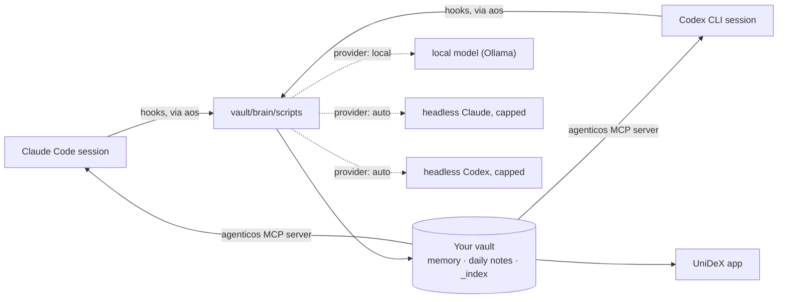

# How it works

How a Claude Code or Codex session reaches the vault, what runs in the background and on which model, and how the graph, the Chief of Staff and the app fit on top. The [README](../README.md#how-it-works) has the short version.

- **Hosts.** A session runs under Claude Code or Codex CLI, and both can share one vault. The runtime is the same; only the wiring differs: Claude Code loads `plugin/`, Codex loads `codex-plugin/`, and both come from the same marketplace. `codex-plugin/` is generated from `plugin/` (`npm run build:codex-plugin`, checked by the tests), so the hooks, the MCP server and the commands stay in lockstep across the two hosts. A Codex CLI without plugin support gets the same pieces written into its own config instead. The three modes are equivalent: **Claude Code only**, **Codex only**, or **both on one vault**. A hook learns which host fired it from one environment variable the wiring sets; the MCP server's entry in each plugin names its host too; where nothing sets it (an `aos` verb run inside a session), the runtime works it out from the session transcript's path, then from the config when only one host is enabled. Which memories reach a session (injected at its start, returned by `recall`, read with `memory_read`) is logged by path, with its host, in `brain/_index/memory-usage.jsonl` (on by default with telemetry; `telemetry.enabled: false` turns both off); no prompt or query is kept. One transcript reader understands both CLIs' session logs, and telemetry records the host and model of every run.
- **Hooks.** Both hosts fire hooks for session start, every prompt, every tool use, stop and session end. Each one runs `aos <script>` inside your vault: inject context, update working memory, stream telemetry, write the heartbeat, cost the session, wrap it, rescan. Under Codex the conventions file is injected at every session start too, since `AGENTS.md` cannot include it. Codex fires session end late in its TUI (thread close, or 30 minutes idle) and, depending on the version, not at all under `codex exec` (0.144 did not, 0.155 does), so a reconcile pass on every session start and stop finishes any run idle for `telemetry.staleAfterMinutes`: it closes the telemetry, costs it and wraps it exactly as session end would have. A Claude Code terminal killed mid-session is healed the same way.
- **Runners.** Persona duties, on the Chief of Staff's model for each host (`claude-opus-5-5`, `gpt-6-sol`), and `prompt` routines without an `engine:` run through `claude -p` when Claude Code is wired and installed, otherwise through `codex exec` (workspace-write sandbox, our hooks off, the spend estimated from its token counts since Codex has no budget flag; the daily caps still gate every start). `persona.runner` and `routines.runner` pin one; `aos doctor` shows the choice. A routine with `engine: local` runs on the built-in local agent instead: this Mac's model with read, list, search, write (only where its `writes:` says) and notify tools, no spend. The Sessions tab's Vault chat answers through the reasoner (below), so it works without the `claude` CLI too, on Codex or the local workhorse; its menu can also send one question to a chosen host and model (`claude -p`, or `ask.js --local --host=codex`), on the reasoner's caps with no fallback to another provider.
- **The vault** is an ordinary folder of Markdown: the memory both hosts share, and what the UniDeX app shows. Its `workspaces/` folder is the home for project working directories of both hosts: a project is anything with a `README.md`, `CLAUDE.md`, `AGENTS.md`, `STATUS.md`, `PLAN.md` or `.git`. Every scan reads each host's transcripts and credits a session to the workspace it started in (the folder, its linked code folder or an alias in its `workspace.md`), to the workspace of the team seat or git worktree it ran in, or, for a session started at the vault root, to the workspace whose files it touched most; the counts cover the last 30 days (`workspaces.idleDays`) on both hosts. Folders whose name starts with `_`, such as `_archive` and `_worktrees`, are hidden from Spaces and left out of Pulse's counts. The Spaces tab lists whatever ran outside a workspace, leaving out home, temp, scratch and job folders and each host's config folder. A workspace's `workspace.md` frontmatter travels with the folder and is what Spaces, and either host's sessions through `aos workspace set`, change: `pinned`, `status` (`active`, `paused` or `done`, which wins over the automatic word), `repo` (its linked code folder) and `aliases` (folders whose sessions count for it: one adopted from the outside list, or its own name before a rename). Archiving moves a workspace into `workspaces/_archive/` with `archived:` set; its sessions stay credited and its Sessions threads stay listed, read-only until it is restored. `AGENTICOS.md` documents the layout and the three-file rule: `MEMORY.md` is the index, `brain/memory/<type>/` holds the content, `brain/_index/BRAIN.md` is the compiled bootstrap injected on the first turn.
- **Providers.** `local`, a new install's default, runs background work on the local engine (Ollama, or an OpenAI-compatible server) with a model sized to the Mac's memory (`qwen3.5:4b` under 12 GB, else `qwen3.5:9b`), counts each call in `brain/_index/local-usage.json` and spends nothing. It is ready only when the model is downloaded (`aos local pull`); while it cannot answer, session wraps wait in a queue and run when it is back, summaries, insights and file maps use their heuristics, the briefing shows the facts alone, and recall uses keyword search; nothing goes to Claude or Codex unless you turn on `local.hostedFallback`. `auto` picks Ollama when it answers, otherwise headless Claude (`claude -p --model haiku`, capped per call and per day, every call ledgered), otherwise headless Codex when Codex is a wired host (`codex exec`, read-only, hooks off, spend estimated from its token counts), otherwise `none`. Under `none` nothing calls a model in the background; summaries are heuristic and `/wrap` extracts memories inside your own session through the `wrap_session` tool. One role is the exception: the **reasoner** behind `/ask-brain --local`, `/reflect-week`, `/consolidate-memory` and the Sessions tab's Vault chat is a hosted model whatever `auto` resolved: Claude (`reasoner.model`, default `claude-opus-5`) when Claude Code is a host and logged in, otherwise Codex when it is a host and logged in (`reasoner.codexModel`, else `codex.model`); an explicit `provider: codex` puts Codex first. It has its own per-call and per-day caps, and falls back to the local workhorse when neither is available or its daily cap is reached. Brain's two model calls each take one of these routes: Merge with AI drafts through the background provider, and the consolidation sweep goes the reasoner's way (Claude, else Codex) under the reasoner's caps but with the background models (`claude.model`, or `codex.model` at `codex.effort`); where nobody hosted can answer and Ollama is up, the sweep runs there. **Under provider `local`** each reasoner feature follows its own switch, `ai.chat` (Vault chat), `ai.ask` (Ask brain), `ai.reflectWeek` and `ai.consolidate`: `local` (the default) runs it on the local model, even with a host signed in, `host` keeps the hosted reasoner above; the sweep and Merge with AI run on the local model too (the sweep sends brain hub's duplicates and clusters in chunks the model can hold). With the local model down, nothing goes to a host unasked: a button offers "Run once on Claude Code/Codex" with the cap it counts against (`--host claude|codex` on `ask.js`, `reflect-week.js`, `consolidate-memory.js` and `aos memory merge-draft|sweep`).
- **The graph.** Every scan ends with a `graph-build` stage: `graphify update <vault>` writes `brain/graphify-out/graph.json`, a structural graph of pages, headings and links clustered into communities, in a second or two and with no model. It skips what `.graphifyignore` and the vault's `.gitignore` list (workspaces, the runtime, caches, templates). graphify is pinned (`aos upgrade` moves it only with a release), lives in a tool dir of its own, and never sees an API key. At most once a day a second stage, `graph-semantic`, runs `graphify extract` in the background: only new or changed notes go to Claude (`claude.model`, through a shim that gives every call the same isolation as the other headless calls — no tools, no hooks, no thinking, `--max-budget-usd`) or, where Codex is the host, to `codex exec` behind the same shim (read-only, no hooks, low effort, spend estimated), which adds concept nodes and `INFERRED` edges. It has its own daily cap, `graph.semantic.perDayUsd` ($1), separate from the hooks'; at the cap the remaining notes wait for the next run. `graph.semantic.enabled` is `auto`: on, unless the provider is `none`. Under provider `local` (or `ollama`) the pass runs on graphify's own local backend at your engine's address instead, one chunk at a time, with no spend, and waits while the Mac is on battery (`local.onBattery`). After the graph build, the scan's `brain-hub` stage distils the graph for the Brain tab's Map into `brain/_index/brain-map.json`: graphify's own communities holding at least `memory.mapMin` memories (8), with the index pages (`MEMORY.md`, the MOCs, `BRAIN.md`) left out, each named by its most-linked memory, the links between them and up to 12 neighbours per memory, with no model call.
- **The Chief of Staff** is built out of the same two pieces: its duties are routine files that the runner starts, and its watchdog is a routine that never calls a model. What it may change on its own is a file contract, not a code path — see [chief-of-staff.md](chief-of-staff.md). Interactive software-development requests use the upstream Superpowers coding workflow when that third-party host plugin is installed and enabled. New setup offers it on each selected host; older installs opt in through Settings or `aos superpowers install`. Codex direct wiring on older CLIs cannot load it until Codex is upgraded to a plugin-capable version.
- **The HUD** reads the same files: the pipeline ledger, live agent runs, the memory graph, provider state, spend, and your agent's identity and flags.
